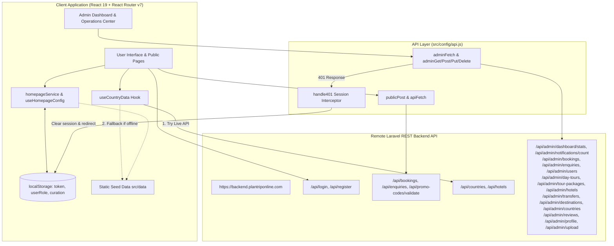
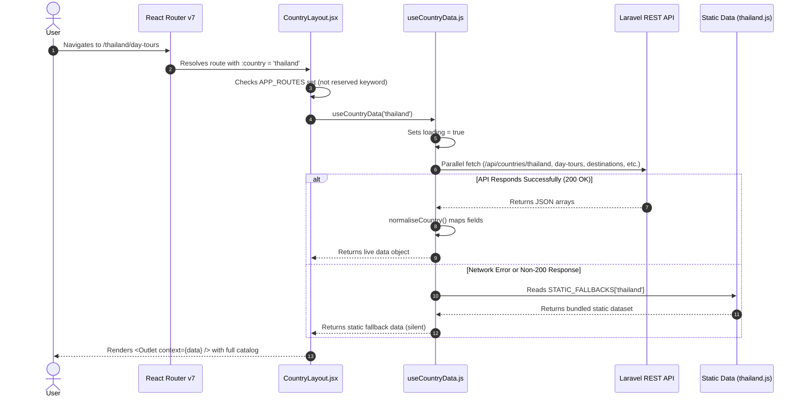
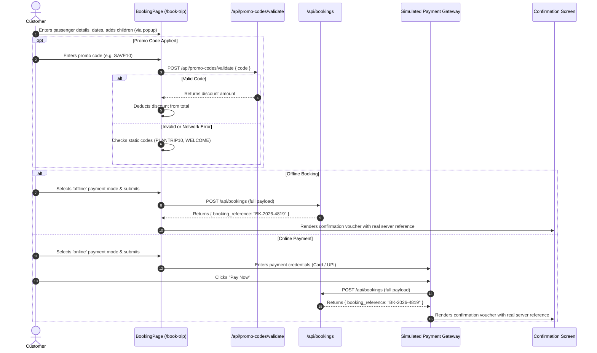

# PlanTripOnline (Frontend) — Project Context & Architectural Specification

> **Status:** Single Source of Truth for `PlanTripOnline-Frontend`  
> **Repository:** `e:\Eurasia Holidays\plantrip\PlanTripOnline-Frontend`  
> **Runtime Target:** React 19.2.8 | Vite 8.3.0 | React Router DOM 7.18.4  
> **Backend Integration:** Laravel REST API (`https://backend.plantriponline.com`)  
> **Document Last Updated:** November 2026 (Updated post-commits `8ad9ef1`, `45f4c94`, `14cfe95`, `c80cfdb`, `fc09183`)  
> **Verification Level:** 100% verified against live source code implementation  

---

## Table of Contents

1. [Project Overview](#1-project-overview)
2. [Technology Stack and Dependencies](#2-technology-stack-and-dependencies)
3. [Project Architecture and Folder Structure](#3-project-architecture-and-folder-structure)
4. [Pages and Routing Structure](#4-pages-and-routing-structure)
5. [Features and Modules](#5-features-and-modules)
6. [API Integrations and Endpoints](#6-api-integrations-and-endpoints)
7. [Reusable Components](#7-reusable-components)
8. [Business Logic and Workflows](#8-business-logic-and-workflows)
9. [Recent Development Updates](#9-recent-development-updates)
10. [Bug Fixes and UI Improvements](#10-bug-fixes-and-ui-improvements)
11. [Important Technical Decisions](#11-important-technical-decisions)
12. [Current Implementation Status](#12-current-implementation-status)
13. [Known Issues and Pending Tasks](#13-known-issues-and-pending-tasks)
14. [Development Setup and Commands](#14-development-setup-and-commands)
15. [Evidence-Based File Reference Index](#15-evidence-based-file-reference-index)

---

## 1. Project Overview

**PlanTripOnline** is an online travel agency (OTA) web platform offering curated day tours, multi-day tourism packages, private airport and city ground transfers, and hotel reservations across Southeast Asia and South Asia (principally **Thailand**, **Malaysia**, and **India**).

The repository `PlanTripOnline-Frontend` is a standalone, client-side Single Page Application (SPA) built using **React 19**, **Vite 8**, and **React Router DOM v7**.

### Architectural Evolution & Operating Model
The application has recently evolved from a purely static catalog showcase into a **hybrid, API-driven travel management platform**:
1. **Public Catalog & Hybrid Content Layer:** Content (destinations, day tours, packages, hotels, and transfers) is primarily fetched live from the remote Laravel backend (`https://backend.plantriponline.com`). If the backend API is unreachable or offline, the client seamlessly and silently falls back to bundled seed datasets (`src/data/thailand.js`, `src/data/malaysia.js`).
2. **Live Booking & Enquiry Engine:** Tour reservations, transfer bookings, bespoke itinerary enquiries, and promotional discount validations are submitted directly to the Laravel backend via public JSON REST endpoints.
3. **Comprehensive Admin Operations Center:** A full-featured, role-gated administrative suite (`/admin-dashboard`) provides real-time operations oversight, revenue tracking, booking approvals, inquiry handling, promo code generation, customer review moderation, CSV bulk data importing, and live visual homepage curation.

### Operating Entities & Corporate Contacts
- **Thailand Operations:** TIC Holidays Co., Ltd, Bangkok, Thailand
- **Malaysia Operations:** TIC Holidays Sdn. Bhd, Kuala Lumpur, Malaysia
- **India Operations:** Eurasia Holidays, Kochi, Kerala, India
- **Customer Support Contacts:** `info@plantriponline.com` | `+60 10 666 1747`

---

## 2. Technology Stack and Dependencies

### Core Framework and Build Tooling
- **React:** `^19.2.8` (Modern functional component paradigm utilizing `useState`, `useEffect`, `useMemo`, `useCallback`, `useRef`, and custom hooks)
- **React DOM:** `^19.2.8` (Web rendering root with React 19 concurrent features)
- **Vite:** `^8.3.0` (Native ES module dev server, Rolldown/Rollup-based production bundler with sub-3-second builds)
- **React Router DOM:** `^7.18.4` (Declarative client routing, nested layouts, outlet context passing, dynamic path parameters)
- **React Helmet Async:** `^3.0.0` (Head document metadata management for dynamic `<title>` and `<meta>` per page)

### Development Tooling & Linters
- **Oxlint:** `^1.81.0` (High-performance Rust-based JavaScript and JSX linter configured with React and OXC rule suites via `.oxlintrc.json`)
- **@vitejs/plugin-react:** `^6.1.1` (Fast Refresh babel/oxc runtime plugin)
- **TypeScript Type Definitions:** `@types/react` `^19.2.18`, `@types/react-dom` `^19.2.7` (Editor IDE intellisense)

### Styling Paradigms
1. **External Global CSS:** Scoped modular stylesheets imported at root or per layout (`src/styles/home.css`, `header.css`, `footer.css`, `country.css`, `globals.css`).
2. **Inline & Embedded Component Styles:** Component-scoped `<style>` tags and style objects used in authentication, booking, and administrative modules (`LoginPage.jsx`, `SignupPage.jsx`, `AdminDashboard.jsx`, `ContentShared.jsx`, `BookingPage.jsx`) to avoid external CSS collision and ensure zero-leak styling.
3. **CSS Modules (Legacy):** `src/pages/Dashboard.module.css` (partially preserved for `UserDashboard`).

---

## 3. Project Architecture and Folder Structure

### Directory Tree

```
PlanTripOnline-Frontend/
├── .oxlintrc.json                      # Oxlint linter configuration
├── index.html                          # Entry HTML shell with Google Fonts (Poppins & Inter)
├── package.json                        # NPM project manifest
├── package-lock.json                   # Exact dependency lockfile
├── vite.config.js                      # Vite bundler configuration
├── public/                             # Static public assets
│   ├── favicon.svg                     # Primary site favicon (SVG)
│   ├── icons.svg                       # Icon sprite definition
│   └── assets/
│       └── favico.png                  # Raster favicon (PNG)
├── src/
│   ├── App.css                         # Global CSS helper classes
│   ├── App.jsx                         # Master routing table & route protection guards
│   ├── index.css                       # CSS reset, typography, and base layout rules
│   ├── main.jsx                        # React root bootstrap with HelmetProvider & BrowserRouter
│   ├── assets/                         # Bundled media assets (hero.png, react.svg, vite.svg)
│   ├── components/                     # Component library
│   │   ├── ProtectedRoute.jsx          # Route guard handling role-based redirects (admin vs user)
│   │   ├── ScrollToTop.jsx             # Window scroll reset on route navigation
│   │   ├── admin/                      # Admin operations console components
│   │   │   ├── AdminOverview.jsx       # Operational metrics dashboard with 7-day revenue chart
│   │   │   ├── AdminProfileSettings.jsx# Name update and password modification form
│   │   │   ├── BookingsList.jsx        # Bookings table with filter, search, slide-out details & status update
│   │   │   ├── EnquiriesList.jsx       # Customer inquiries management with status workflow & notes
│   │   │   ├── PromoCodesList.jsx      # Promo code CRUD manager (% or fixed discounts, limits, expiry)
│   │   │   ├── UsersList.jsx           # Registered users list with role toggle, search, edit & delete
│   │   │   └── content/                # Content catalog and CMS modules
│   │   │       ├── ContentShared.jsx   # Shared UI components (CountrySelect, ImageUpload, SlidePanel, etc.)
│   │   │       ├── CountriesManager.jsx# Country management CRUD with flag, currency, descriptions
│   │   │       ├── DayToursManager.jsx # Day tours CRUD, destination tagging, and CSV bulk import
│   │   │       ├── DestinationsManager.jsx # Two-level country-to-destination hierarchy manager
│   │   │       ├── HomePageManager.jsx # Live visual homepage curation (Hero, Carousel, Trending tours)
│   │   │       ├── HotelsManager.jsx   # Hotel inventory CRUD, destination tagging, and CSV bulk import
│   │   │       ├── ReviewsManager.jsx  # Customer reviews moderation (Approve, Reject, Delete)
│   │   │       ├── TourPackagesManager.jsx # Multi-day package CRUD, destination tagging, and CSV bulk import
│   │   │       └── TransfersManager.jsx# Private ground transfers CRUD and CSV bulk import
│   │   ├── country/                    # Country-specific views and sub-module pages
│   │   │   ├── CountryLayout.jsx       # Dynamic data loader with fallback and route collision guard
│   │   │   ├── CustomizedPackages.jsx  # Custom trip landing showcase
│   │   │   ├── DayTours.jsx            # Day tours listing with location filter & search
│   │   │   ├── DestinationDetail.jsx   # Specific destination hub with linked tours/hotels/packages
│   │   │   ├── Destinations.jsx        # Grid of regional destinations within a country
│   │   │   ├── HotelDetail.jsx         # Full hotel detail view with amenities, stars, booking enquiry
│   │   │   ├── Hotels.jsx              # Hotel accommodations catalog with category filters
│   │   │   ├── PackageDetail.jsx       # Multi-day package detail, itinerary timeline & booking drawer
│   │   │   ├── TourDetail.jsx          # Day tour detail view with booking drawer & add-ons
│   │   │   ├── TourPackages.jsx        # Curated multi-day package itineraries catalog
│   │   │   ├── TransferDetail.jsx      # Private transfer booking form with online/offline checkout
│   │   │   └── Transfers.jsx           # Ground transfers catalog and vehicle filter
│   │   ├── home/                       # Homepage constituent sections
│   │   │   ├── DestinationCarousel.jsx # 3D CSS transform destination carousel (curated dynamically)
│   │   │   ├── Hero.jsx                # Full-bleed hero banner with live curated country pill links
│   │   │   ├── PackagesGrid.jsx        # Country exploration cards and action triggers
│   │   │   └── ToursGrid.jsx           # Featured trending day tours grid (curated dynamically)
│   │   └── layout/                     # Master layout scaffolding
│   │       ├── Footer.jsx              # Multi-column footer with office maps and corporate info
│   │       ├── Header.jsx              # Responsive desktop/mobile navbar with auth & country context
│   │       └── Layout.jsx              # Frame rendering Header, Outlet, and Footer
│   ├── config/
│   │   └── api.js                      # Centralized API layer (adminFetch, publicPost, 401 interceptor)
│   ├── data/                           # Seed & fallback static datasets
│   │   ├── constants.js                # Legacy script (unreferenced)
│   │   ├── global.js                   # Corporate identity, offices, social links, currency formatter
│   │   ├── homeData.js                 # Seed carousel items, trending tours, and carousel physics
│   │   ├── index.js                    # Country lookup dispatcher (`getCountryData`)
│   │   ├── malaysia.js                 # Malaysia dataset (tours, hotels, destinations, transfers)
│   │   └── thailand.js                 # Thailand dataset (tours, hotels, destinations, transfers)
│   ├── hooks/                          # Custom React hooks
│   │   ├── useAdminApi.js              # useAdminApi and useAdminList with abort controller & query building
│   │   └── useCountryData.js           # Hybrid live-API fetcher with silent fallback to static seed data
│   ├── pages/                          # Top-level application pages
│   │   ├── AboutPage.jsx               # Informational page (placeholder)
│   │   ├── AdminDashboard.jsx          # Modern operations center with collapsible sidebar & notifications
│   │   ├── BookingPage.jsx             # Master 3-step checkout engine connected to live booking API
│   │   ├── ContactPage.jsx             # Contact information page (placeholder)
│   │   ├── CookiesPage.jsx             # Cookie policy page (placeholder)
│   │   ├── Dashboard.module.css        # CSS module for UserDashboard
│   │   ├── DestinationToursPage.jsx    # Tours list filtered by selected destination state
│   │   ├── EnquiryPage.jsx             # Bespoke travel enquiry form connected to live backend API
│   │   ├── FaqPage.jsx                 # FAQ page (placeholder)
│   │   ├── ForgotPasswordPage.jsx      # Password recovery view
│   │   ├── HomePage.jsx                # Public homepage aggregating home sections
│   │   ├── LoginPage.jsx               # Auth sign-in with interactive animated eye pupil & session alert
│   │   ├── NotFoundPage.jsx            # 404 fallback page
│   │   ├── PlanTripPage.jsx            # Tour overview, itinerary tabs & checkout dispatcher
│   │   ├── PrivacyPage.jsx             # Privacy policy statement (placeholder)
│   │   ├── SignupPage.jsx              # Account registration form with dual eye animation
│   │   ├── TermsPage.jsx               # Terms of service page (placeholder)
│   │   ├── UserDashboard.jsx           # Traveler profile dashboard shell
│   │   └── country/
│   │       └── CountryPage.jsx         # Country landing hero, highlights, and catalog entry points
│   ├── services/
│   │   └── homepageService.js          # Homepage curation engine: seed + live catalog blending & event bus
│   └── styles/                         # Shared CSS stylesheets
│       ├── country.css                 # Country layout and catalog styling
│       ├── footer.css                  # Footer and SVG mountain-ridge styling
│       ├── globals.css                 # Reset, typography, color tokens, and container classes
│       ├── header.css                  # Header navbar, mobile drawer, and dropdown styles
│       └── home.css                    # Hero, tour card grids, carousel, and responsive rules
```

### Application Architecture Diagram



---

## 4. Pages and Routing Structure

Routes are declared in [`src/App.jsx`](file:///e:/Eurasia%20Holidays/plantrip/PlanTripOnline-Frontend/src/App.jsx).

### Important Route Scoring Architecture
In React Router DOM v7, dynamic splat routes such as `/:country/*` can unintentionally conflict with top-level sub-routes. To prevent route collision, **explicit route declarations** are used for all admin sub-paths:
`['', 'home-page', 'bookings', 'enquiries', 'users', 'promo-codes', 'day-tours', 'tour-packages', 'hotels', 'transfers', 'destinations', 'reviews', 'settings', 'offices', 'countries', 'profile']`.
Additionally, [`CountryLayout.jsx`](file:///e:/Eurasia%20Holidays/plantrip/PlanTripOnline-Frontend/src/components/country/CountryLayout.jsx) incorporates an `APP_ROUTES` hard guard Set to reject any application route names that might leak into the `:country` parameter.

### Comprehensive Route Inventory Table

| HTTP Route / Path | Component | Layout Wrapper | Auth Guard | Description & Implementation Details |
| :--- | :--- | :--- | :--- | :--- |
| `/` | [`HomePage`](file:///e:/Eurasia%20Holidays/plantrip/PlanTripOnline-Frontend/src/pages/HomePage.jsx) | `<Layout>` | Public | Displays dynamic Hero banner, 3D Carousel, Trending Day Tours, and Journey Cards. Synchronized with live admin curation via `homepageService`. |
| `/login` | [`LoginPage`](file:///e:/Eurasia%20Holidays/plantrip/PlanTripOnline-Frontend/src/pages/LoginPage.jsx) | None | Public | Sign-in page with interactive SVG eye pupil animation. Supports session expiration banner (`?session=expired`), stores `token`, `userRole`, `userName`, `userEmail`, and navigates based on role. |
| `/signup` | [`SignupPage`](file:///e:/Eurasia%20Holidays/plantrip/PlanTripOnline-Frontend/src/pages/SignupPage.jsx) | None | Public | Account registration form with dual animated eyes. Submits to `/api/register`. |
| `/forgot-password` | [`ForgotPasswordPage`](file:///e:/Eurasia%20Holidays/plantrip/PlanTripOnline-Frontend/src/pages/ForgotPasswordPage.jsx) | None | Public | Password recovery form with feedback message. |
| `/enquiry` | [`EnquiryPage`](file:///e:/Eurasia%20Holidays/plantrip/PlanTripOnline-Frontend/src/pages/EnquiryPage.jsx) | None | Public | Comprehensive bespoke travel inquiry form. Submits payload to live backend endpoint `POST /api/enquiries` and presents a full-screen confirmation overlay. |
| `/plan-trip` | [`PlanTripPage`](file:///e:/Eurasia%20Holidays/plantrip/PlanTripOnline-Frontend/src/pages/PlanTripPage.jsx) | None | Public | 4-tab tour/destination review page (Overview, Inclusions, Itinerary, Reviews). Dispatches to `/book-trip`. |
| `/destination-tours` | [`DestinationToursPage`](file:///e:/Eurasia%20Holidays/plantrip/PlanTripOnline-Frontend/src/pages/DestinationToursPage.jsx) | None | Public | Lists all day tours for a selected destination name. Dispatches to `/plan-trip`. |
| `/book-trip` | [`BookingPage`](file:///e:/Eurasia%20Holidays/plantrip/PlanTripOnline-Frontend/src/pages/BookingPage.jsx) | None | Public | 3-step checkout engine: passenger details, live promo validation against `/api/promo-codes/validate`, simulated payment, and live submission to `POST /api/bookings`. Generates real server booking reference. |
| `/admin-dashboard` | [`AdminDashboard`](file:///e:/Eurasia%20Holidays/plantrip/PlanTripOnline-Frontend/src/pages/AdminDashboard.jsx) | Protected | `adminOnly` | Operations Overview displaying live KPI statistics (`/api/admin/dashboard/stats`), 7-day revenue bar chart, and recent bookings. |
| `/admin-dashboard/home-page` | [`HomePageManager`](file:///e:/Eurasia%20Holidays/plantrip/PlanTripOnline-Frontend/src/components/admin/content/HomePageManager.jsx) | Protected (`AdminDashboard`) | `adminOnly` | Live visual homepage curation manager for Hero country tags, Carousel cards, and Trending tours. |
| `/admin-dashboard/bookings` | [`BookingsList`](file:///e:/Eurasia%20Holidays/plantrip/PlanTripOnline-Frontend/src/components/admin/BookingsList.jsx) | Protected (`AdminDashboard`) | `adminOnly` | Paginated bookings management with search, status filters, slide-out details panel, inline status changes, and deletion. |
| `/admin-dashboard/enquiries` | [`EnquiriesList`](file:///e:/Eurasia%20Holidays/plantrip/PlanTripOnline-Frontend/src/components/admin/EnquiriesList.jsx) | Protected (`AdminDashboard`) | `adminOnly` | Customer inquiries management console with status tracking (`pending`, `in_progress`, `completed`), notes, and deletion. |
| `/admin-dashboard/users` | [`UsersList`](file:///e:/Eurasia%20Holidays/plantrip/PlanTripOnline-Frontend/src/components/admin/UsersList.jsx) | Protected (`AdminDashboard`) | `adminOnly` | User account management console with search, role filters, edit slide-out, and user deletion. |
| `/admin-dashboard/promo-codes` | [`PromoCodesList`](file:///e:/Eurasia%20Holidays/plantrip/PlanTripOnline-Frontend/src/components/admin/PromoCodesList.jsx) | Protected (`AdminDashboard`) | `adminOnly` | Promo code CRUD manager supporting percentage/fixed discounts, minimum order limits, usage caps, and expiry dates. |
| `/admin-dashboard/day-tours` | [`DayToursManager`](file:///e:/Eurasia%20Holidays/plantrip/PlanTripOnline-Frontend/src/components/admin/content/DayToursManager.jsx) | Protected (`AdminDashboard`) | `adminOnly` | Day tours CRUD with country filter, destination city tagging, image upload, features, and CSV bulk import. |
| `/admin-dashboard/tour-packages` | [`TourPackagesManager`](file:///e:/Eurasia%20Holidays/plantrip/PlanTripOnline-Frontend/src/components/admin/content/TourPackagesManager.jsx) | Protected (`AdminDashboard`) | `adminOnly` | Multi-day package itineraries CRUD with destination tagging, inclusions, and CSV bulk import. |
| `/admin-dashboard/hotels` | [`HotelsManager`](file:///e:/Eurasia%20Holidays/plantrip/PlanTripOnline-Frontend/src/components/admin/content/HotelsManager.jsx) | Protected (`AdminDashboard`) | `adminOnly` | Hotel accommodations CRUD with star rating, categories, destination tagging, amenities, and CSV bulk import. |
| `/admin-dashboard/transfers` | [`TransfersManager`](file:///e:/Eurasia%20Holidays/plantrip/PlanTripOnline-Frontend/src/components/admin/content/TransfersManager.jsx) | Protected (`AdminDashboard`) | `adminOnly` | Ground transport routes CRUD with vehicle lists, route duration, destination tagging, and CSV bulk import. |
| `/admin-dashboard/destinations` | [`DestinationsManager`](file:///e:/Eurasia%20Holidays/plantrip/PlanTripOnline-Frontend/src/components/admin/content/DestinationsManager.jsx) | Protected (`AdminDashboard`) | `adminOnly` | Two-level destination manager: Country cards grid $\rightarrow$ sub-destination listings per country with highlights and imagery. |
| `/admin-dashboard/countries` | [`CountriesManager`](file:///e:/Eurasia%20Holidays/plantrip/PlanTripOnline-Frontend/src/components/admin/content/CountriesManager.jsx) | Protected (`AdminDashboard`) | `adminOnly` | Country records manager with currency symbols, flag emojis, descriptions, and cache invalidation. |
| `/admin-dashboard/reviews` | [`ReviewsManager`](file:///e:/Eurasia%20Holidays/plantrip/PlanTripOnline-Frontend/src/components/admin/content/ReviewsManager.jsx) | Protected (`AdminDashboard`) | `adminOnly` | Customer reviews moderation console with quick approve, reject, detail review, admin notes, and deletion. |
| `/admin-dashboard/profile` | [`AdminProfileSettings`](file:///e:/Eurasia%20Holidays/plantrip/PlanTripOnline-Frontend/src/components/admin/AdminProfileSettings.jsx) | Protected (`AdminDashboard`) | `adminOnly` | Admin profile settings for updating display name and changing account password. |
| `/user-dashboard/*` | [`UserDashboard`](file:///e:/Eurasia%20Holidays/plantrip/PlanTripOnline-Frontend/src/pages/UserDashboard.jsx) | Protected | `userOnly` | Traveler personal dashboard shell. |
| `/:country` | [`CountryPage`](file:///e:/Eurasia%20Holidays/plantrip/PlanTripOnline-Frontend/src/pages/country/CountryPage.jsx) | `<Layout>` > `<CountryLayout>` | Public | Dynamic country landing page displaying hero, top destinations, featured tours, and packages. |
| `/:country/day-tours` | [`DayTours`](file:///e:/Eurasia%20Holidays/plantrip/PlanTripOnline-Frontend/src/components/country/DayTours.jsx) | `<Layout>` > `<CountryLayout>` | Public | Day tours catalog with location filtering, date/guest inputs, and links to tour detail. |
| `/:country/tours/:tourSlug` | [`TourDetail`](file:///e:/Eurasia%20Holidays/plantrip/PlanTripOnline-Frontend/src/components/country/TourDetail.jsx) | `<Layout>` > `<CountryLayout>` | Public | Tour detail view with itinerary timeline, inclusions, booking drawer, child age modal, add-on options, and prefill to checkout. |
| `/:country/tour-packages` | [`TourPackages`](file:///e:/Eurasia%20Holidays/plantrip/PlanTripOnline-Frontend/src/components/country/TourPackages.jsx) | `<Layout>` > `<CountryLayout>` | Public | Multi-day tour packages catalog with live search filter and highlight cards. |
| `/:country/package/:packageSlug` | [`PackageDetail`](file:///e:/Eurasia%20Holidays/plantrip/PlanTripOnline-Frontend/src/components/country/PackageDetail.jsx) | `<Layout>` > `<CountryLayout>` | Public | Multi-day package detail view with daily itinerary, hotel/flight fields, and checkout dispatcher. |
| `/:country/hotels` | [`Hotels`](file:///e:/Eurasia%20Holidays/plantrip/PlanTripOnline-Frontend/src/components/country/Hotels.jsx) | `<Layout>` > `<CountryLayout>` | Public | Hotel accommodations catalog featuring search, guest counts, and category tabs. |
| `/:country/hotels/:hotelSlug` | [`HotelDetail`](file:///e:/Eurasia%20Holidays/plantrip/PlanTripOnline-Frontend/src/components/country/HotelDetail.jsx) | `<Layout>` > `<CountryLayout>` | Public | **Fully Implemented:** Detailed hotel showcase with hero, stars, amenity emoji parser, booking/inquiry sidebar with night calculation, and prefill to `/enquiry`. |
| `/:country/destinations` | [`Destinations`](file:///e:/Eurasia%20Holidays/plantrip/PlanTripOnline-Frontend/src/components/country/Destinations.jsx) | `<Layout>` > `<CountryLayout>` | Public | Regional destination cards showcase with search filtering. |
| `/:country/destinations/:destSlug` | [`DestinationDetail`](file:///e:/Eurasia%20Holidays/plantrip/PlanTripOnline-Frontend/src/components/country/DestinationDetail.jsx) | `<Layout>` > `<CountryLayout>` | Public | Regional destination hub displaying matched day tours, hotels, and packages. |
| `/:country/transfers` | [`Transfers`](file:///e:/Eurasia%20Holidays/plantrip/PlanTripOnline-Frontend/src/components/country/Transfers.jsx) | `<Layout>` > `<CountryLayout>` | Public | Private ground transfer catalog with vehicle tags and pricing. |
| `/:country/transfers/:transferSlug` | [`TransferDetail`](file:///e:/Eurasia%20Holidays/plantrip/PlanTripOnline-Frontend/src/components/country/TransferDetail.jsx) | `<Layout>` > `<CountryLayout>` | Public | Transfer booking engine: vehicle fleet upgrades, live promo code validation, instant offline booking submit to `/api/bookings`, and receipt generation. |
| `/:country/customized-packages` | [`CustomizedPackages`](file:///e:/Eurasia%20Holidays/plantrip/PlanTripOnline-Frontend/src/components/country/CustomizedPackages.jsx) | `<Layout>` > `<CountryLayout>` | Public | Value proposition landing page with CTA to `/enquiry`. |
| `*` | [`NotFoundPage`](file:///e:/Eurasia%20Holidays/plantrip/PlanTripOnline-Frontend/src/pages/NotFoundPage.jsx) | `<Layout>` | Public | 404 Fallback page. |

---

## 5. Features and Modules

### 1. Homepage & Live Visual Curation Engine
- **Files:** [`HomePage.jsx`](file:///e:/Eurasia%20Holidays/plantrip/PlanTripOnline-Frontend/src/pages/HomePage.jsx), [`Hero.jsx`](file:///e:/Eurasia%20Holidays/plantrip/PlanTripOnline-Frontend/src/components/home/Hero.jsx), [`DestinationCarousel.jsx`](file:///e:/Eurasia%20Holidays/plantrip/PlanTripOnline-Frontend/src/components/home/DestinationCarousel.jsx), [`ToursGrid.jsx`](file:///e:/Eurasia%20Holidays/plantrip/PlanTripOnline-Frontend/src/components/home/ToursGrid.jsx), [`PackagesGrid.jsx`](file:///e:/Eurasia%20Holidays/plantrip/PlanTripOnline-Frontend/src/components/home/PackagesGrid.jsx), [`homepageService.js`](file:///e:/Eurasia%20Holidays/plantrip/PlanTripOnline-Frontend/src/services/homepageService.js), [`HomePageManager.jsx`](file:///e:/Eurasia%20Holidays/plantrip/PlanTripOnline-Frontend/src/components/admin/content/HomePageManager.jsx).
- **Core Functionality:**
  - Administrators can select, toggle, and reorder existing database and seed items to feature on the homepage:
    1. Hero "Popular Destinations" Country Pills (`heroCountrySlugs`).
    2. Popular Destinations 3D Carousel Cards (`carouselDestKeys`).
    3. Trending Day Tours Grid Cards (`trendingTourKeys`).
  - Active curation settings are stored in `localStorage` under `plantrip_homepage_curation_v2` and broadcast reactively via a custom `plantrip_homepage_changed` window event.
  - Public consumers use the `useHomepageConfig()` hook to automatically react to admin curation changes across open browser tabs without page reloads.

### 2. Hybrid Country Content Subsystem
- **Files:** [`CountryLayout.jsx`](file:///e:/Eurasia%20Holidays/plantrip/PlanTripOnline-Frontend/src/components/country/CountryLayout.jsx), [`useCountryData.js`](file:///e:/Eurasia%20Holidays/plantrip/PlanTripOnline-Frontend/src/hooks/useCountryData.js).
- **Core Functionality:**
  - When a user visits `/:country/*`, [`CountryLayout.jsx`](file:///e:/Eurasia%20Holidays/plantrip/PlanTripOnline-Frontend/src/components/country/CountryLayout.jsx) invokes [`useCountryData(slug)`](file:///e:/Eurasia%20Holidays/plantrip/PlanTripOnline-Frontend/src/hooks/useCountryData.js).
  - Parallel API requests fetch `/api/countries/${slug}`, `/day-tours`, `/destinations`, `/hotels`, `/tour-packages`, and `/transfers`.
  - If any API fails or the server is offline, it activates a **silent fallback** to static files (`thailand.js`, `malaysia.js`), ensuring zero user disruption.
  - Normalizes server snake_case fields into the camelCase structures expected by frontend components.
  - Includes an animated CSS spinner during data resolution and a route guard redirecting reserved app route names.

### 3. Hotel Accommodations & Detailed View
- **Files:** [`Hotels.jsx`](file:///e:/Eurasia%20Holidays/plantrip/PlanTripOnline-Frontend/src/components/country/Hotels.jsx), [`HotelDetail.jsx`](file:///e:/Eurasia%20Holidays/plantrip/PlanTripOnline-Frontend/src/components/country/HotelDetail.jsx).
- **Core Functionality:**
  - `HotelDetail.jsx` has been fully implemented (603 lines of production code).
  - Searches context data first, then fetches dynamically from `/api/hotels/${hotelSlug}` or query param `?slug=`.
  - Dynamic **Amenity Emoji Parser** mapping 27+ amenities (WiFi, Pool, Gym, Spa, Dining, Rooftop, Jacuzzi, Beach, etc.) to intuitive visual badges.
  - Dynamic star renderer (`Stars`), luxury/budget badge coloring (`badgeStyle`), check-in/out date calculations, adult/child selector, and night price computations.
  - Dispatches directly to `/enquiry` with prefilled hotel parameters in router state.

### 4. Ground Transport & Private Transfers
- **Files:** [`Transfers.jsx`](file:///e:/Eurasia%20Holidays/plantrip/PlanTripOnline-Frontend/src/components/country/Transfers.jsx), [`TransferDetail.jsx`](file:///e:/Eurasia%20Holidays/plantrip/PlanTripOnline-Frontend/src/components/country/TransferDetail.jsx).
- **Core Functionality:**
  - Private transfer booking with city pickup locations, vehicle tier selection (Sedan, SUV, Van, Minibus), and flight details.
  - **Live Promo Code Validation:** Interacts with `POST /api/promo-codes/validate` (with fallback to static codes).
  - **Live Booking Creation:** Offline bookings are immediately submitted to `POST /api/bookings`, returning a real server reference code (e.g., `BK-2026-XXXX`).

### 5. Master Reservation & Payment Engine
- **Files:** [`BookingPage.jsx`](file:///e:/Eurasia%20Holidays/plantrip/PlanTripOnline-Frontend/src/pages/BookingPage.jsx).
- **Core Functionality:**
  - 3-step checkout engine (`form` $\rightarrow$ `payment` $\rightarrow$ `success`).
  - Interactive child age modal with individual age tracking (`kids` array).
  - Live promo code validation through `publicPost('/api/promo-codes/validate', { code })` with static fallback (`PLANTRIP10`, `WELCOME`, `SAVE10`).
  - Direct submission of complete booking records to `POST /api/bookings`. Captures and displays server-generated booking reference.
  - Printable confirmation voucher with printable stylesheet rules.

### 6. Bespoke Travel Enquiry Subsystem
- **Files:** [`EnquiryPage.jsx`](file:///e:/Eurasia%20Holidays/plantrip/PlanTripOnline-Frontend/src/pages/EnquiryPage.jsx).
- **Core Functionality:**
  - Replaced simulated alert with direct backend dispatch to `POST /api/enquiries` using `publicPost`.
  - Captures full customer details, travel destination, travel type, start date, duration, and special notes.
  - Full-screen animated success confirmation modal displaying submitted email, phone, and 24-hour SLA promise.
  - In-form error banner alerting users if backend submission fails.

### 7. Administrative Operations Suite
- **Files:** [`AdminDashboard.jsx`](file:///e:/Eurasia%20Holidays/plantrip/PlanTripOnline-Frontend/src/pages/AdminDashboard.jsx) and `src/components/admin/*`.
- **Core Functionality:**
  - **Modern UI Redesign:** Dark themed sidebar with 3 sections (`Main`, `Content`, `Settings`), smooth collapsible state (250px $\leftrightarrow$ 70px) with floating tooltips, active indicator dot, and mobile responsive drawer.
  - **Notification Alert Bell:** Topbar bell polling `GET /api/admin/notifications/count` every 60s, aggregating pending bookings, enquiries, and reviews into a badge indicator.
  - **Error Boundary:** `PanelErrorBoundary` isolates individual sub-panel errors, showing a friendly "Try Again" fallback without crashing the entire dashboard.
  - **KPIs & Analytics:** Live operational statistics from `GET /api/admin/dashboard/stats`, 5 gradient KPI cards, and 7-day revenue bar chart.
  - **Bookings Management:** Server-side search & filtering, slide-out drawer, status modifications (`pending`, `confirmed`, `cancelled`, `completed`), payment status updates (`unpaid`, `paid`, `refunded`), and deletion.
  - **Enquiries Management:** Status workflow (`pending`, `in_progress`, `completed`, `cancelled`), internal admin notes, and deletion.
  - **Promo Codes CRUD:** Percentage or fixed discount types, minimum order spend, usage limits, and expiration dates.
  - **Users Management:** Initials avatar, role management (`Admin`, `User`), status toggling, and deletion.
  - **Profile & Security Settings:** Self-service name updating and password change form with match validation.
  - **Catalog Management (Tours, Packages, Hotels, Transfers, Destinations, Countries):**
    - Two-level destination hierarchy (Country $\rightarrow$ Sub-destinations).
    - Destination tagging across all catalog items.
    - **CSV Bulk Import:** Client-side CSV parsing enabling bulk creation of day tours, packages, hotels, and transfers in seconds.
    - Image Upload component supporting both URL paste and file upload to `/api/admin/upload` with automatic fallback advice if the server endpoint is unconfigured.
  - **Customer Reviews Moderation:** Star ratings, customer feedback review, one-click Approve/Reject, and deletion via `GET/PUT/DELETE /api/admin/reviews`.

---

## 6. API Integrations and Endpoints

Communication with the backend (`https://backend.plantriponline.com`) is handled through [`src/config/api.js`](file:///e:/Eurasia%20Holidays/plantrip/PlanTripOnline-Frontend/src/config/api.js).

### API Client Architecture
- `apiFetch(endpoint, options)`: Public fetch wrapper with JSON headers.
- `adminFetch(endpoint, options)`: Authenticated fetch wrapper injecting `Authorization: Bearer <token>` from `localStorage`.
- `handle401()`: Auto-logout interceptor. Whenever any admin call receives a `401 Unauthorized`, it clears `token`, `userRole`, `userName`, `userEmail` from `localStorage` and redirects to `/login?session=expired`.
- Convenience methods: `adminGet`, `adminPost`, `adminPut`, `adminPatch`, `adminDelete`.
- `adminUpload(file)`: Sends `multipart/form-data` to `/api/admin/upload`.
- `publicPost(endpoint, body)`: Convenience POST wrapper for public forms.

### Complete API Endpoint Inventory

| HTTP Method & Endpoint | Caller / Consuming File | Auth Required | Request Body / Parameters | Description & Expected Response |
| :--- | :--- | :--- | :--- | :--- |
| `POST /api/login` | [`LoginPage.jsx`](file:///e:/Eurasia%20Holidays/plantrip/PlanTripOnline-Frontend/src/pages/LoginPage.jsx) | No | `{ email, password }` | Authenticates user credentials. Returns `{ token, user: { name, email, role } }`. |
| `POST /api/register` | [`SignupPage.jsx`](file:///e:/Eurasia%20Holidays/plantrip/PlanTripOnline-Frontend/src/pages/SignupPage.jsx) | No | `{ name, email, country, phone, password, password_confirmation }` | Registers user account. Returns `{ token, user }`. |
| `POST /api/bookings` | [`BookingPage.jsx`](file:///e:/Eurasia%20Holidays/plantrip/PlanTripOnline-Frontend/src/pages/BookingPage.jsx), [`TransferDetail.jsx`](file:///e:/Eurasia%20Holidays/plantrip/PlanTripOnline-Frontend/src/components/country/TransferDetail.jsx) | No | `{ destination, country, first_name, last_name, email, phone, whatsapp, travel_date, adults, children, pick_up, drop_point, payment_method, promo_code, subtotal, discount, taxes, total_amount, currency }` | Creates a new customer booking. Returns `{ booking_reference: string, ... }`. |
| `POST /api/enquiries` | [`EnquiryPage.jsx`](file:///e:/Eurasia%20Holidays/plantrip/PlanTripOnline-Frontend/src/pages/EnquiryPage.jsx) | No | `{ full_name, email, phone, country, destination, travel_type, start_date, duration, message }` | Submits a bespoke travel inquiry. Returns success status. |
| `POST /api/promo-codes/validate` | [`BookingPage.jsx`](file:///e:/Eurasia%20Holidays/plantrip/PlanTripOnline-Frontend/src/pages/BookingPage.jsx), [`TransferDetail.jsx`](file:///e:/Eurasia%20Holidays/plantrip/PlanTripOnline-Frontend/src/components/country/TransferDetail.jsx) | No | `{ code: string }` | Validates promo code discount eligibility. Returns `{ discount_value: number, type: string }`. |
| `GET /api/countries/:slug` | [`useCountryData.js`](file:///e:/Eurasia%20Holidays/plantrip/PlanTripOnline-Frontend/src/hooks/useCountryData.js) | No | None | Fetches country metadata bundle. |
| `GET /api/countries/:slug/day-tours` | [`useCountryData.js`](file:///e:/Eurasia%20Holidays/plantrip/PlanTripOnline-Frontend/src/hooks/useCountryData.js) | No | None | Fetches all day tours for a country. |
| `GET /api/countries/:slug/destinations` | [`useCountryData.js`](file:///e:/Eurasia%20Holidays/plantrip/PlanTripOnline-Frontend/src/hooks/useCountryData.js) | No | None | Fetches all destinations for a country. |
| `GET /api/countries/:slug/hotels` | [`useCountryData.js`](file:///e:/Eurasia%20Holidays/plantrip/PlanTripOnline-Frontend/src/hooks/useCountryData.js) | No | None | Fetches all hotels for a country. |
| `GET /api/countries/:slug/tour-packages` | [`useCountryData.js`](file:///e:/Eurasia%20Holidays/plantrip/PlanTripOnline-Frontend/src/hooks/useCountryData.js) | No | None | Fetches all tour packages for a country. |
| `GET /api/countries/:slug/transfers` | [`useCountryData.js`](file:///e:/Eurasia%20Holidays/plantrip/PlanTripOnline-Frontend/src/hooks/useCountryData.js) | No | None | Fetches all transfers for a country. |
| `GET /api/hotels/:hotelSlug` | [`HotelDetail.jsx`](file:///e:/Eurasia%20Holidays/plantrip/PlanTripOnline-Frontend/src/components/country/HotelDetail.jsx) | No | None | Fetches specific hotel details by slug or query param. |
| `GET /api/admin/dashboard/stats` | [`AdminOverview.jsx`](file:///e:/Eurasia%20Holidays/plantrip/PlanTripOnline-Frontend/src/components/admin/AdminOverview.jsx) | Bearer Token | None | Returns operational stats: `{ total_users, active_bookings, total_revenue, active_packages, pending_enquiries, revenue_chart: { labels, data }, recent_bookings }`. |
| `GET /api/admin/notifications/count` | [`AdminDashboard.jsx`](file:///e:/Eurasia%20Holidays/plantrip/PlanTripOnline-Frontend/src/pages/AdminDashboard.jsx) | Bearer Token | None | Returns pending notification counts: `{ pending_bookings, pending_enquiries, pending_reviews }`. |
| `GET /api/admin/bookings` | [`BookingsList.jsx`](file:///e:/Eurasia%20Holidays/plantrip/PlanTripOnline-Frontend/src/components/admin/BookingsList.jsx) | Bearer Token | Query: `search`, `status`, `payment_status`, `per_page` | Returns paginated list of customer bookings. |
| `PUT /api/admin/bookings/:id` | [`BookingsList.jsx`](file:///e:/Eurasia%20Holidays/plantrip/PlanTripOnline-Frontend/src/components/admin/BookingsList.jsx) | Bearer Token | `{ status, payment_status, admin_notes }` | Updates booking status or admin notes. |
| `DELETE /api/admin/bookings/:id` | [`BookingsList.jsx`](file:///e:/Eurasia%20Holidays/plantrip/PlanTripOnline-Frontend/src/components/admin/BookingsList.jsx) | Bearer Token | None | Deletes booking record. |
| `GET /api/admin/enquiries` | [`EnquiriesList.jsx`](file:///e:/Eurasia%20Holidays/plantrip/PlanTripOnline-Frontend/src/components/admin/EnquiriesList.jsx) | Bearer Token | Query: `search`, `status`, `per_page` | Returns paginated customer travel inquiries. |
| `PUT /api/admin/enquiries/:id` | [`EnquiriesList.jsx`](file:///e:/Eurasia%20Holidays/plantrip/PlanTripOnline-Frontend/src/components/admin/EnquiriesList.jsx) | Bearer Token | `{ status, notes }` | Updates inquiry status and notes. |
| `DELETE /api/admin/enquiries/:id` | [`EnquiriesList.jsx`](file:///e:/Eurasia%20Holidays/plantrip/PlanTripOnline-Frontend/src/components/admin/EnquiriesList.jsx) | Bearer Token | None | Deletes travel inquiry. |
| `GET /api/admin/users` | [`UsersList.jsx`](file:///e:/Eurasia%20Holidays/plantrip/PlanTripOnline-Frontend/src/components/admin/UsersList.jsx) | Bearer Token | Query: `search`, `role`, `per_page` | Returns registered users list. |
| `PUT /api/admin/users/:id` | [`UsersList.jsx`](file:///e:/Eurasia%20Holidays/plantrip/PlanTripOnline-Frontend/src/components/admin/UsersList.jsx) | Bearer Token | `{ name, role, status }` | Updates user profile and privileges. |
| `DELETE /api/admin/users/:id` | [`UsersList.jsx`](file:///e:/Eurasia%20Holidays/plantrip/PlanTripOnline-Frontend/src/components/admin/UsersList.jsx) | Bearer Token | None | Deletes registered user account. |
| `GET /api/admin/promo-codes` | [`PromoCodesList.jsx`](file:///e:/Eurasia%20Holidays/plantrip/PlanTripOnline-Frontend/src/components/admin/PromoCodesList.jsx) | Bearer Token | None | Lists all promotional discount codes. |
| `POST /api/admin/promo-codes` | [`PromoCodesList.jsx`](file:///e:/Eurasia%20Holidays/plantrip/PlanTripOnline-Frontend/src/components/admin/PromoCodesList.jsx) | Bearer Token | `{ code, type, value, min_amount, max_uses, expires_at, is_active }` | Creates a new promo code. |
| `PUT /api/admin/promo-codes/:id` | [`PromoCodesList.jsx`](file:///e:/Eurasia%20Holidays/plantrip/PlanTripOnline-Frontend/src/components/admin/PromoCodesList.jsx) | Bearer Token | `{ code, type, value, min_amount, max_uses, expires_at, is_active }` | Updates existing promo code. |
| `DELETE /api/admin/promo-codes/:id` | [`PromoCodesList.jsx`](file:///e:/Eurasia%20Holidays/plantrip/PlanTripOnline-Frontend/src/components/admin/PromoCodesList.jsx) | Bearer Token | None | Deletes promo code. |
| `GET /api/admin/countries` | [`CountriesManager.jsx`](file:///e:/Eurasia%20Holidays/plantrip/PlanTripOnline-Frontend/src/components/admin/content/CountriesManager.jsx), [`ContentShared.jsx`](file:///e:/Eurasia%20Holidays/plantrip/PlanTripOnline-Frontend/src/components/admin/content/ContentShared.jsx) | Bearer Token | None | Lists countries for CMS and selectors. |
| `POST /api/admin/countries` | [`CountriesManager.jsx`](file:///e:/Eurasia%20Holidays/plantrip/PlanTripOnline-Frontend/src/components/admin/content/CountriesManager.jsx) | Bearer Token | `{ name, slug, flag, currency_code, currency_symbol, description, is_active }` | Creates country record. |
| `PUT /api/admin/countries/:id` | [`CountriesManager.jsx`](file:///e:/Eurasia%20Holidays/plantrip/PlanTripOnline-Frontend/src/components/admin/content/CountriesManager.jsx) | Bearer Token | `{ ...countryFields }` | Updates country record. |
| `DELETE /api/admin/countries/:id` | [`CountriesManager.jsx`](file:///e:/Eurasia%20Holidays/plantrip/PlanTripOnline-Frontend/src/components/admin/content/CountriesManager.jsx) | Bearer Token | None | Deletes country record. |
| `GET /api/admin/destinations` | [`DestinationsManager.jsx`](file:///e:/Eurasia%20Holidays/plantrip/PlanTripOnline-Frontend/src/components/admin/content/DestinationsManager.jsx), [`ContentShared.jsx`](file:///e:/Eurasia%20Holidays/plantrip/PlanTripOnline-Frontend/src/components/admin/content/ContentShared.jsx) | Bearer Token | Query: `country_id`, `per_page` | Lists destinations filtered by country. |
| `POST /api/admin/destinations` | [`DestinationsManager.jsx`](file:///e:/Eurasia%20Holidays/plantrip/PlanTripOnline-Frontend/src/components/admin/content/DestinationsManager.jsx) | Bearer Token | `{ country_id, name, slug, badge, image, description, highlights, is_active }` | Creates destination record. |
| `PUT /api/admin/destinations/:id` | [`DestinationsManager.jsx`](file:///e:/Eurasia%20Holidays/plantrip/PlanTripOnline-Frontend/src/components/admin/content/DestinationsManager.jsx) | Bearer Token | `{ ...destFields }` | Updates destination record. |
| `DELETE /api/admin/destinations/:id` | [`DestinationsManager.jsx`](file:///e:/Eurasia%20Holidays/plantrip/PlanTripOnline-Frontend/src/components/admin/content/DestinationsManager.jsx) | Bearer Token | None | Deletes destination record. |
| `GET /api/admin/day-tours` | [`DayToursManager.jsx`](file:///e:/Eurasia%20Holidays/plantrip/PlanTripOnline-Frontend/src/components/admin/content/DayToursManager.jsx) | Bearer Token | Query: `per_page` | Lists day tours for admin management. |
| `POST /api/admin/day-tours` | [`DayToursManager.jsx`](file:///e:/Eurasia%20Holidays/plantrip/PlanTripOnline-Frontend/src/components/admin/content/DayToursManager.jsx) | Bearer Token | `{ title, slug, location, price, duration, badge, description, image, country_id, destination_id, is_active, is_featured, features }` | Creates day tour (single or via CSV import). |
| `PUT /api/admin/day-tours/:id` | [`DayToursManager.jsx`](file:///e:/Eurasia%20Holidays/plantrip/PlanTripOnline-Frontend/src/components/admin/content/DayToursManager.jsx) | Bearer Token | `{ ...tourFields }` | Updates day tour record. |
| `DELETE /api/admin/day-tours/:id` | [`DayToursManager.jsx`](file:///e:/Eurasia%20Holidays/plantrip/PlanTripOnline-Frontend/src/components/admin/content/DayToursManager.jsx) | Bearer Token | None | Deletes day tour record. |
| `GET /api/admin/tour-packages` | [`TourPackagesManager.jsx`](file:///e:/Eurasia%20Holidays/plantrip/PlanTripOnline-Frontend/src/components/admin/content/TourPackagesManager.jsx) | Bearer Token | Query: `per_page` | Lists tour packages. |
| `POST /api/admin/tour-packages` | [`TourPackagesManager.jsx`](file:///e:/Eurasia%20Holidays/plantrip/PlanTripOnline-Frontend/src/components/admin/content/TourPackagesManager.jsx) | Bearer Token | `{ title, subtitle, slug, badge, price, duration, image, description, includes, country_id, destination_id, is_active, is_featured }` | Creates package (single or via CSV import). |
| `PUT /api/admin/tour-packages/:id` | [`TourPackagesManager.jsx`](file:///e:/Eurasia%20Holidays/plantrip/PlanTripOnline-Frontend/src/components/admin/content/TourPackagesManager.jsx) | Bearer Token | `{ ...pkgFields }` | Updates package record. |
| `DELETE /api/admin/tour-packages/:id` | [`TourPackagesManager.jsx`](file:///e:/Eurasia%20Holidays/plantrip/PlanTripOnline-Frontend/src/components/admin/content/TourPackagesManager.jsx) | Bearer Token | None | Deletes package record. |
| `GET /api/admin/hotels` | [`HotelsManager.jsx`](file:///e:/Eurasia%20Holidays/plantrip/PlanTripOnline-Frontend/src/components/admin/content/HotelsManager.jsx) | Bearer Token | Query: `per_page` | Lists hotels for CMS. |
| `POST /api/admin/hotels` | [`HotelsManager.jsx`](file:///e:/Eurasia%20Holidays/plantrip/PlanTripOnline-Frontend/src/components/admin/content/HotelsManager.jsx) | Bearer Token | `{ title, slug, destination, location, category, stars, price, image, badge, amenities, description, country_id, destination_id, is_active, is_featured }` | Creates hotel (single or via CSV import). |
| `PUT /api/admin/hotels/:id` | [`HotelsManager.jsx`](file:///e:/Eurasia%20Holidays/plantrip/PlanTripOnline-Frontend/src/components/admin/content/HotelsManager.jsx) | Bearer Token | `{ ...hotelFields }` | Updates hotel record. |
| `DELETE /api/admin/hotels/:id` | [`HotelsManager.jsx`](file:///e:/Eurasia%20Holidays/plantrip/PlanTripOnline-Frontend/src/components/admin/content/HotelsManager.jsx) | Bearer Token | None | Deletes hotel record. |
| `GET /api/admin/transfers` | [`TransfersManager.jsx`](file:///e:/Eurasia%20Holidays/plantrip/PlanTripOnline-Frontend/src/components/admin/content/TransfersManager.jsx) | Bearer Token | Query: `per_page` | Lists ground transfers. |
| `POST /api/admin/transfers` | [`TransfersManager.jsx`](file:///e:/Eurasia%20Holidays/plantrip/PlanTripOnline-Frontend/src/components/admin/content/TransfersManager.jsx) | Bearer Token | `{ title, slug, from_location, to_location, duration, price, vehicles, image, description, country_id, destination_id, is_active }` | Creates transfer route (single or via CSV import). |
| `PUT /api/admin/transfers/:id` | [`TransfersManager.jsx`](file:///e:/Eurasia%20Holidays/plantrip/PlanTripOnline-Frontend/src/components/admin/content/TransfersManager.jsx) | Bearer Token | `{ ...transferFields }` | Updates transfer route. |
| `DELETE /api/admin/transfers/:id` | [`TransfersManager.jsx`](file:///e:/Eurasia%20Holidays/plantrip/PlanTripOnline-Frontend/src/components/admin/content/TransfersManager.jsx) | Bearer Token | None | Deletes transfer route. |
| `GET /api/admin/reviews` | [`ReviewsManager.jsx`](file:///e:/Eurasia%20Holidays/plantrip/PlanTripOnline-Frontend/src/components/admin/content/ReviewsManager.jsx) | Bearer Token | Query: `status`, `search` | Lists customer reviews. |
| `PUT /api/admin/reviews/:id` | [`ReviewsManager.jsx`](file:///e:/Eurasia%20Holidays/plantrip/PlanTripOnline-Frontend/src/components/admin/content/ReviewsManager.jsx) | Bearer Token | `{ status: 'approved'\|'rejected', admin_note }` | Updates review status and admin note. |
| `DELETE /api/admin/reviews/:id` | [`ReviewsManager.jsx`](file:///e:/Eurasia%20Holidays/plantrip/PlanTripOnline-Frontend/src/components/admin/content/ReviewsManager.jsx) | Bearer Token | None | Deletes customer review. |
| `PUT /api/admin/profile` | [`AdminProfileSettings.jsx`](file:///e:/Eurasia%20Holidays/plantrip/PlanTripOnline-Frontend/src/components/admin/AdminProfileSettings.jsx) | Bearer Token | `{ name: string }` | Updates admin profile display name. |
| `PUT /api/admin/profile/password` | [`AdminProfileSettings.jsx`](file:///e:/Eurasia%20Holidays/plantrip/PlanTripOnline-Frontend/src/components/admin/AdminProfileSettings.jsx) | Bearer Token | `{ current_password, new_password, new_password_confirmation }` | Changes admin account password. |
| `POST /api/admin/upload` | [`ContentShared.jsx`](file:///e:/Eurasia%20Holidays/plantrip/PlanTripOnline-Frontend/src/components/admin/content/ContentShared.jsx), [`api.js`](file:///e:/Eurasia%20Holidays/plantrip/PlanTripOnline-Frontend/src/config/api.js) | Bearer Token | `FormData` with `file` | Uploads media file. Returns `{ url: string }`. |

---

## 7. Reusable Components

### Shared UI & Form Components

| Component | Source Path | Main Purpose |
| :--- | :--- | :--- |
| `ProtectedRoute` | [`src/components/ProtectedRoute.jsx`](file:///e:/Eurasia%20Holidays/plantrip/PlanTripOnline-Frontend/src/components/ProtectedRoute.jsx) | Role-aware route guard inspecting `token` and `userRole`/`userEmail`. Cross-redirects non-admins to `/user-dashboard` and admins to `/admin-dashboard`. |
| `ScrollToTop` | [`src/components/ScrollToTop.jsx`](file:///e:/Eurasia%20Holidays/plantrip/PlanTripOnline-Frontend/src/components/ScrollToTop.jsx) | Resets window scroll coordinate to `(0, 0)` upon route change. |
| `Header` | [`src/components/layout/Header.jsx`](file:///e:/Eurasia%20Holidays/plantrip/PlanTripOnline-Frontend/src/components/layout/Header.jsx) | Sticky navigation bar with click-lock country dropdowns, mobile navigation drawer, and user profile avatar. |
| `Footer` | [`src/components/layout/Footer.jsx`](file:///e:/Eurasia%20Holidays/plantrip/PlanTripOnline-Frontend/src/components/layout/Footer.jsx) | Mountain-ridge SVG banner, legal navigation links, social icons, and embedded Google Maps for Thailand, Malaysia, and India offices. |
| `Layout` | [`src/components/layout/Layout.jsx`](file:///e:/Eurasia%20Holidays/plantrip/PlanTripOnline-Frontend/src/components/layout/Layout.jsx) | Structural layout shell nesting Header, `<Outlet />`, and Footer. |
| `CountryLayout` | [`src/components/country/CountryLayout.jsx`](file:///e:/Eurasia%20Holidays/plantrip/PlanTripOnline-Frontend/src/components/country/CountryLayout.jsx) | Dynamic country context loader incorporating `APP_ROUTES` safety set, animated loading spinner, and fallback error banner. |
| `CountrySelect` | [`src/components/admin/content/ContentShared.jsx`](file:///e:/Eurasia%20Holidays/plantrip/PlanTripOnline-Frontend/src/components/admin/content/ContentShared.jsx) | Cached country dropdown select populated once per browser session via `useCountries()`. |
| `DestinationSelect` | [`src/components/admin/content/ContentShared.jsx`](file:///e:/Eurasia%20Holidays/plantrip/PlanTripOnline-Frontend/src/components/admin/content/ContentShared.jsx) | Dependent destination dropdown filtered dynamically by selected `countryId`. |
| `CountryFilterBar` | [`src/components/admin/content/ContentShared.jsx`](file:///e:/Eurasia%20Holidays/plantrip/PlanTripOnline-Frontend/src/components/admin/content/ContentShared.jsx) | Search text input + country filter select pill bar + reload button for catalog tables. |
| `SlidePanel` | [`src/components/admin/content/ContentShared.jsx`](file:///e:/Eurasia%20Holidays/plantrip/PlanTripOnline-Frontend/src/components/admin/content/ContentShared.jsx) | Accessible slide-out editing drawer with backdrop blur and `Escape` key close listener. |
| `ImageUpload` | [`src/components/admin/content/ContentShared.jsx`](file:///e:/Eurasia%20Holidays/plantrip/PlanTripOnline-Frontend/src/components/admin/content/ContentShared.jsx) | Dual-tab image manager: "Paste URL" vs "Upload File" (via `/api/admin/upload`), with preview thumbnail and clear button. |
| `ActiveToggle` | [`src/components/admin/content/ContentShared.jsx`](file:///e:/Eurasia%20Holidays/plantrip/PlanTripOnline-Frontend/src/components/admin/content/ContentShared.jsx) | Interactive pill button toggling item active/inactive status. |
| `SaveButton` | [`src/components/admin/content/ContentShared.jsx`](file:///e:/Eurasia%20Holidays/plantrip/PlanTripOnline-Frontend/src/components/admin/content/ContentShared.jsx) | Submit button with disabled loading state (`⏳ Saving…`) and gradient highlight. |
| `FormMessage` | [`src/components/admin/content/ContentShared.jsx`](file:///e:/Eurasia%20Holidays/plantrip/PlanTripOnline-Frontend/src/components/admin/content/ContentShared.jsx) | Feedback alert box styling success (`✓`) green and errors (`⚠️`) red. |
| `ChildAgePopup` | [`src/pages/BookingPage.jsx`](file:///e:/Eurasia%20Holidays/plantrip/PlanTripOnline-Frontend/src/pages/BookingPage.jsx), [`TourDetail.jsx`](file:///e:/Eurasia%20Holidays/plantrip/PlanTripOnline-Frontend/src/components/country/TourDetail.jsx), etc. | Modal popup prompting for individual child age (0–17) with validation before adding to passenger state. |

---

## 8. Business Logic and Workflows

### 1. Hybrid Dynamic Data Resolution Sequence
When viewing any country sub-route (e.g., `/thailand/day-tours`), data is retrieved using an API-first approach with transparent static fallback:



### 2. Live Booking Submission Sequence



### 3. Pricing Calculation Rules

#### In [`BookingPage.jsx`](file:///e:/Eurasia%20Holidays/plantrip/PlanTripOnline-Frontend/src/pages/BookingPage.jsx):
$$\text{Subtotal} = (\text{Adults} \times 120) + (\text{Children} \times 70)$$
$$\text{Discount} = \text{promoDiscount} \quad (\text{derived from live validation or static fallback})$$
$$\text{Taxes} = \text{round}\Big((\text{Subtotal} - \text{Discount}) \times 0.05\Big)$$
$$\text{Total} = \max(0, \, \text{Subtotal} - \text{Discount} + \text{Taxes})$$

#### In [`TransferDetail.jsx`](file:///e:/Eurasia%20Holidays/plantrip/PlanTripOnline-Frontend/src/components/country/TransferDetail.jsx):
$$\text{Vehicle Extra} = \begin{cases} \$0 & \text{Sedan} \\ \$15 & \text{SUV} \\ \$25 & \text{Van} \\ \$40 & \text{Minibus} \end{cases}$$
$$\text{Price Per Person} = \text{Base Rate} + \text{Vehicle Extra}$$
$$\text{Subtotal} = (\text{Price Per Person} \times \text{Adults}) + (\text{Price Per Person} \times 0.5 \times \text{Children})$$
$$\text{Discount} = 10\% \text{ of Subtotal} \quad (\text{if promo code applied})$$

---

## 9. Recent Development Updates

Thorough code difference review confirms that between commits `159932f` and `fc09183`, developer **AKHIL V J** made significant architectural upgrades and feature additions across **31 files** (+7,475 lines, -451 lines):

### 1. Commit `8ad9ef1` — *admin page upgrades*
- Created foundational API layer in `src/config/api.js` (`adminFetch`, `adminGet`, `adminPost`, `adminPut`, `adminDelete`, `handle401`).
- Added initial data management hooks `useAdminApi` and `useAdminList`.
- Scaffolded CRUD manager panels for Day Tours, Packages, Hotels, Transfers, Countries, and Destinations.

### 2. Commit `45f4c94` — *bug fixes*
- Fixed country slug routing collisions in `CountryLayout.jsx` by establishing the `APP_ROUTES` safety set.
- Resolved token parsing and authentication error alerts in `LoginPage.jsx` and `SignupPage.jsx`.
- Added `publicPost` helper in `api.js` for non-authenticated public form submissions.

### 3. Commit `14cfe95` — *updates*
- Implemented real backend submission in `BookingPage.jsx` (`POST /api/bookings`) and `EnquiryPage.jsx` (`POST /api/enquiries`).
- Added live promo code validation via `POST /api/promo-codes/validate` with graceful fallback to local codes.
- Completed full production implementation of `HotelDetail.jsx` (603 lines), replacing the previous 1-line placeholder.
- Added live booking submission and promo code validation to `TransferDetail.jsx`.

### 4. Commit `c80cfdb` — *New Modern Look Admin Panel, Destinations Upgrade, Bulk Upload, Reviews Manager, Notifications & Profile*
- **Modern Look Admin Panel:** Redesigned `AdminDashboard.jsx` with dark gradient sidebar, 3 categorized navigation groups (`Main`, `Content`, `Settings`), smooth 250px $\leftrightarrow$ 70px collapsible transition, and mobile responsive drawer.
- **Top-Bar Notifications:** Added notification alert bell polling `GET /api/admin/notifications/count` every 60s for pending bookings, enquiries, and reviews.
- **Destinations Upgraded:** Restructured `DestinationsManager.jsx` into a two-level hierarchy (Country cards grid $\rightarrow$ sub-destinations per country). Added `DestinationSelect` to tag tours, packages, hotels, and transfers with specific destination cities.
- **CSV Bulk Import:** Implemented client-side CSV parsing in `DayToursManager.jsx`, `TourPackagesManager.jsx`, `HotelsManager.jsx`, and `TransfersManager.jsx` to upload catalog items in bulk.
- **Reviews Manager:** Created `ReviewsManager.jsx` to approve, reject, review, and delete customer reviews via `GET/PUT/DELETE /api/admin/reviews`.
- **Profile & Password Settings:** Created `AdminProfileSettings.jsx` supporting name modifications (`PUT /api/admin/profile`) and password updates (`PUT /api/admin/profile/password`).
- **Session Expiration Handling:** Updated `handle401()` and `LoginPage.jsx` to display a user-friendly notice (`?session=expired`) when JWT tokens expire.

### 5. Commit `fc09183` — *homepage control*
- Built `src/services/homepageService.js` to manage homepage curation state across seed data and live API records.
- Created `HomePageManager.jsx` (1,077 lines) allowing admins to visually toggle and reorder Hero country pills, 3D Carousel destination cards, and Trending Day Tours grid cards.
- Integrated `useHomepageConfig` hook into `Hero.jsx`, `DestinationCarousel.jsx`, and `ToursGrid.jsx` to dynamically render curated selections.

---

## 10. Bug Fixes and UI Improvements

1. **Route Scoring Collision Fix (`App.jsx` & `CountryLayout.jsx`):**
   - In React Router DOM v7, the parameter route `/:country/*` previously intercepted nested admin views like `/admin-dashboard/users`. Fixed by registering explicit sub-routes for every admin sub-path in `App.jsx` and adding an `APP_ROUTES` hard guard Set in `CountryLayout.jsx`.
2. **Session Expiry & 401 Interception (`api.js` & `LoginPage.jsx`):**
   - Fixed silent authentication failures where expired tokens left users on broken admin screens. Now automatically purges localStorage and redirects to `/login?session=expired` with an orange warning alert.
3. **Role Determination Logic (`ProtectedRoute.jsx` & `LoginPage.jsx`):**
   - Fixed rigid email check (`userEmail === 'admin@plantriponline.com'`) to also evaluate the explicit `userRole` returned by the Laravel API (`userRole === 'admin'`).
   - Added bidirectional protection: non-admins attempting to view admin pages are redirected to `/user-dashboard`; admins attempting to view `/user-dashboard` are redirected to `/admin-dashboard`.
4. **Interactive Eye Pupil Animation State:**
   - Ensured smooth cleanup of global `mousemove` event listeners in `LoginPage.jsx` and `SignupPage.jsx` when toggling password visibility or unmounting.
5. **Child Age Popup Validation:**
   - Fixed child passenger input by enforcing integer age bounds (0–17) with dedicated modal popups across booking and detail views.
6. **Live Booking Reference Display:**
   - Updated success screens in `BookingPage.jsx` and `TransferDetail.jsx` to display the actual server-generated reference code in monospace font.

---

## 11. Important Technical Decisions

1. **Explicit Admin Sub-Routing over Wildcards:**
   - In React Router v7, explicit static paths outscore dynamic parameters. Registering 16 explicit routes for `/admin-dashboard/*` ensures admin panels load reliably without being captured by `/:country`.
2. **Hybrid Static/API Data Layer with Silent Fallback:**
   - Public country browsing is fast and resilient because `useCountryData` attempts live API fetching while retaining local JavaScript seed datasets as a silent fallback if the backend service is offline.
3. **Reactive Local Event Bus for Homepage Curation:**
   - Rather than requiring backend database migrations for homepage flags, `homepageService.js` leverages `localStorage` (`plantrip_homepage_curation_v2`) combined with window `storage` and `plantrip_homepage_changed` events, delivering instant multi-tab reactivity.
4. **Client-Side CSV Parsing for Bulk Uploads:**
   - Instead of complex multi-part server queue uploads, CSVs are parsed directly in the browser (`parseCSV`), validated line-by-line, and posted sequentially to existing REST endpoints with live progress counters.
5. **Component-Scoped Style Tag Isolation:**
   - High-complexity administrative consoles and detail views use inline and embedded `<style>` blocks. This eliminates CSS class collision risks with global stylesheets while avoiding additional build dependencies.

---

## 12. Current Implementation Status

| Module / Screen | Implementation Status | Data Source / Integration | Notes |
| :--- | :--- | :--- | :--- |
| **Homepage** | ✅ 100% Production Ready | Dynamic (`homepageService` + seeds) | Curated via `HomePageManager`. Hero, 3D Carousel, Trending Tours. |
| **Country Landing (`/:country`)** | ✅ 100% Production Ready | Hybrid (`useCountryData` + fallback) | Fully functional for Thailand and Malaysia. |
| **Day Tours Listing & Details** | ✅ 100% Production Ready | Hybrid | Location filters, itinerary tabs, child popup, add-ons. |
| **Tour Packages Listing & Details** | ✅ 100% Production Ready | Hybrid | Multi-day timeline, inclusions, booking drawer. |
| **Transfers Listing & Details** | ✅ 100% Production Ready | Hybrid + Live API | Online/offline booking connected to `POST /api/bookings`. |
| **Hotel Accommodations (`Hotels.jsx`)** | ✅ 100% Production Ready | Hybrid | Search, categories, dates/guests selector. |
| **Hotel Detail (`HotelDetail.jsx`)** | ✅ 100% Production Ready | Live API (`/api/hotels/:slug`) + context | 603 lines: Stars, 27+ amenity emoji parser, booking drawer. |
| **Booking Checkout (`BookingPage.jsx`)** | ✅ 100% Production Ready | Live API (`/api/bookings`, `/validate`) | 3-step checkout, live promo check, server booking ref, print voucher. |
| **Enquiry Page (`EnquiryPage.jsx`)** | ✅ 100% Production Ready | Live API (`POST /api/enquiries`) | Form validation, full-screen success confirmation overlay. |
| **Auth Views (Login, Signup)** | ✅ 100% Production Ready | Live API (`/api/login`, `/api/register`) | Eye pupil animations, role routing, session expiry alert. |
| **Admin Overview** | ✅ 100% Production Ready | Live API (`/api/admin/dashboard/stats`) | 5 KPI cards, 7-day revenue chart, recent bookings table. |
| **Admin Notifications** | ✅ 100% Production Ready | Live API (`/api/admin/notifications/count`)| 60-second polling alert bell in topbar. |
| **Admin Bookings List** | ✅ 100% Production Ready | Live API (`/api/admin/bookings`) | Search, status filters, slide-out details, inline edit & delete. |
| **Admin Enquiries List** | ✅ 100% Production Ready | Live API (`/api/admin/enquiries`) | Search, status workflow (`pending` $\rightarrow$ `completed`), notes. |
| **Admin Users List** | ✅ 100% Production Ready | Live API (`/api/admin/users`) | Avatar initials, role toggle, search, edit & delete. |
| **Admin Promo Codes** | ✅ 100% Production Ready | Live API (`/api/admin/promo-codes`) | CRUD for percentage and fixed discount codes. |
| **Admin Day Tours Manager** | ✅ 100% Production Ready | Live API (`/api/admin/day-tours`) | Full CRUD, destination city tagging, and CSV bulk import. |
| **Admin Tour Packages Manager**| ✅ 100% Production Ready | Live API (`/api/admin/tour-packages`) | Full CRUD, destination tagging, and CSV bulk import. |
| **Admin Hotels Manager** | ✅ 100% Production Ready | Live API (`/api/admin/hotels`) | Full CRUD, categories, star ratings, and CSV bulk import. |
| **Admin Transfers Manager** | ✅ 100% Production Ready | Live API (`/api/admin/transfers`) | Full CRUD, vehicle fleet, duration, and CSV bulk import. |
| **Admin Destinations Manager** | ✅ 100% Production Ready | Live API (`/api/admin/destinations`) | Two-level hierarchy (Country $\rightarrow$ Sub-destinations). |
| **Admin Countries Manager** | ✅ 100% Production Ready | Live API (`/api/admin/countries`) | Country CRUD with flags, currency symbols, descriptions. |
| **Admin Reviews Manager** | ✅ 100% Production Ready | Live API (`/api/admin/reviews`) | Customer reviews moderation (Approve, Reject, Delete). |
| **Admin Profile Settings** | ✅ 100% Production Ready | Live API (`/api/admin/profile/*`) | Display name update, password modification. |
| **Admin Homepage Manager** | ✅ 100% Production Ready | Live API + localStorage (`homepageService`)| Visual toggle and reorder for hero, carousel, and tours. |
| **User Dashboard** | ⚠️ Partial Shell | Static / Mock | Shows trip count placeholders. Sub-routes not yet built. |
| **Informational Pages** | ⚠️ Coming Soon Stubs | Static | `AboutPage`, `ContactPage`, `FaqPage`, `PrivacyPage`, `TermsPage`, `CookiesPage`. |

---

## 13. Known Issues and Pending Tasks

### 1. Oxlint Rules of Hooks Warning in `DestinationCarousel.jsx`
- **Issue:** In [`src/components/home/DestinationCarousel.jsx`](file:///e:/Eurasia%20Holidays/plantrip/PlanTripOnline-Frontend/src/components/home/DestinationCarousel.jsx#L13), an early return condition `if (!destinations || destinations.length === 0) return null;` is placed **before** the definitions of `updateCarousel`, `nextSlide`, `prevSlide` (`useCallback`), and `useEffect`.
- **Impact:** Oxlint reports 4 errors (`react-hooks/rules-of-hooks: React Hook is called conditionally`). The Vite production build still succeeds, but this early return should be moved below all hook declarations in the next code iteration to ensure hook order consistency.

### 2. Backend `/api/admin/upload` Endpoint Requirement
- **Issue:** In [`ContentShared.jsx`](file:///e:/Eurasia%20Holidays/plantrip/PlanTripOnline-Frontend/src/components/admin/content/ContentShared.jsx), the `ImageUpload` component supports direct file uploads to `POST /api/admin/upload`. If the backend has not yet configured this endpoint, uploads return a 404 error.
- **Handling:** The component automatically detects 404 responses and directs the administrator to use "Paste URL" mode instead.

### 3. User Dashboard Sub-Views
- **Issue:** [`UserDashboard.jsx`](file:///e:/Eurasia%20Holidays/plantrip/PlanTripOnline-Frontend/src/pages/UserDashboard.jsx) is currently a dashboard shell. Endpoints for customer trip history, saved favorites, and traveler profile editing need to be integrated when the backend exposes user-facing booking query APIs.

### 4. Informational Static Pages
- **Issue:** Pages for `AboutPage`, `ContactPage`, `FaqPage`, `PrivacyPage`, `TermsPage`, and `CookiesPage` currently display "Coming Soon" placeholder messages and should be populated with actual corporate copy.

---

## 14. Development Setup and Commands

### Prerequisites
- **Node.js:** v18.0.0 or higher
- **npm:** v9.0.0 or higher

### Key CLI Commands

```bash
# 1. Install all dependencies
npm install

# 2. Start Vite development server with HMR
npm run dev
# Accessible at http://localhost:5173

# 3. Run Oxlint code analysis
npm run lint

# 4. Compile optimized production distribution
npm run build
# Production build outputs to dist/ (compiled in ~2.4s)

# 5. Preview production build locally
npm run preview
```

### Build Distribution Profile
- `dist/index.html`: ~0.75 kB (gzip: ~0.43 kB)
- `dist/assets/index-*.css`: ~28.21 kB (gzip: ~6.47 kB)
- `dist/assets/index-*.js`: ~933 kB (gzip: ~213 kB)

---

## 15. Evidence-Based File Reference Index

| File Path | Component / Unit | Primary Responsibility |
| :--- | :--- | :--- |
| [`src/App.jsx`](file:///e:/Eurasia%20Holidays/plantrip/PlanTripOnline-Frontend/src/App.jsx) | `App` | Master application routing table configuring 30+ public and 16 explicit administrative sub-routes. |
| [`src/components/ProtectedRoute.jsx`](file:///e:/Eurasia%20Holidays/plantrip/PlanTripOnline-Frontend/src/components/ProtectedRoute.jsx) | `ProtectedRoute` | Role-aware route guard handling `token`, `userRole`, and `userEmail` verification. |
| [`src/config/api.js`](file:///e:/Eurasia%20Holidays/plantrip/PlanTripOnline-Frontend/src/config/api.js) | API Helpers | Central API configuration, `adminFetch`, `publicPost`, and `handle401` auto-logout interceptor. |
| [`src/hooks/useAdminApi.js`](file:///e:/Eurasia%20Holidays/plantrip/PlanTripOnline-Frontend/src/hooks/useAdminApi.js) | `useAdminApi`, `useAdminList` | Admin data fetching hooks with filter serialization and request cancellation (`AbortController`). |
| [`src/hooks/useCountryData.js`](file:///e:/Eurasia%20Holidays/plantrip/PlanTripOnline-Frontend/src/hooks/useCountryData.js) | `useCountryData` | Hybrid country catalog loader with live REST parallel fetching and silent static fallback. |
| [`src/services/homepageService.js`](file:///e:/Eurasia%20Holidays/plantrip/PlanTripOnline-Frontend/src/services/homepageService.js) | Homepage Engine | Homepage curation engine blending seeds with live catalog records, localStorage, and event bus. |
| [`src/pages/AdminDashboard.jsx`](file:///e:/Eurasia%20Holidays/plantrip/PlanTripOnline-Frontend/src/pages/AdminDashboard.jsx) | `AdminDashboard` | Redesigned operations center: collapsible sidebar, 60s notification polling bell, `PanelErrorBoundary`. |
| [`src/components/admin/AdminOverview.jsx`](file:///e:/Eurasia%20Holidays/plantrip/PlanTripOnline-Frontend/src/components/admin/AdminOverview.jsx) | `AdminOverview` | Operational overview: 5 gradient KPI cards, 7-day revenue chart, recent bookings table. |
| [`src/components/admin/BookingsList.jsx`](file:///e:/Eurasia%20Holidays/plantrip/PlanTripOnline-Frontend/src/components/admin/BookingsList.jsx) | `BookingsList` | Bookings table with search, status filters, slide-out drawer, status updating, and deletion. |
| [`src/components/admin/EnquiriesList.jsx`](file:///e:/Eurasia%20Holidays/plantrip/PlanTripOnline-Frontend/src/components/admin/EnquiriesList.jsx) | `EnquiriesList` | Customer travel inquiries console with status workflow, notes, and deletion. |
| [`src/components/admin/PromoCodesList.jsx`](file:///e:/Eurasia%20Holidays/plantrip/PlanTripOnline-Frontend/src/components/admin/PromoCodesList.jsx) | `PromoCodesList` | Promo code CRUD manager (% or fixed discounts, minimum spend, expiry, usage limits). |
| [`src/components/admin/UsersList.jsx`](file:///e:/Eurasia%20Holidays/plantrip/PlanTripOnline-Frontend/src/components/admin/UsersList.jsx) | `UsersList` | Registered users console with initials avatar, role toggle, search, edit & delete. |
| [`src/components/admin/AdminProfileSettings.jsx`](file:///e:/Eurasia%20Holidays/plantrip/PlanTripOnline-Frontend/src/components/admin/AdminProfileSettings.jsx) | `AdminProfileSettings` | Profile management for updating admin display name and changing account password. |
| [`src/components/admin/content/ContentShared.jsx`](file:///e:/Eurasia%20Holidays/plantrip/PlanTripOnline-Frontend/src/components/admin/content/ContentShared.jsx) | Shared CMS Widgets | `useCountries`, `DestinationSelect`, `CountryFilterBar`, `SlidePanel`, `ImageUpload`, `SaveButton`. |
| [`src/components/admin/content/CountriesManager.jsx`](file:///e:/Eurasia%20Holidays/plantrip/PlanTripOnline-Frontend/src/components/admin/content/CountriesManager.jsx) | `CountriesManager` | Country CRUD manager with currency, flags, descriptions, and cache invalidation. |
| [`src/components/admin/content/DestinationsManager.jsx`](file:///e:/Eurasia%20Holidays/plantrip/PlanTripOnline-Frontend/src/components/admin/content/DestinationsManager.jsx) | `DestinationsManager` | Two-level destination hierarchy manager (Country cards $\rightarrow$ sub-destination items). |
| [`src/components/admin/content/DayToursManager.jsx`](file:///e:/Eurasia%20Holidays/plantrip/PlanTripOnline-Frontend/src/components/admin/content/DayToursManager.jsx) | `DayToursManager` | Day tours CRUD with country select, destination city tagging, and CSV bulk import. |
| [`src/components/admin/content/TourPackagesManager.jsx`](file:///e:/Eurasia%20Holidays/plantrip/PlanTripOnline-Frontend/src/components/admin/content/TourPackagesManager.jsx) | `TourPackagesManager` | Multi-day package itineraries CRUD with destination tagging and CSV bulk import. |
| [`src/components/admin/content/HotelsManager.jsx`](file:///e:/Eurasia%20Holidays/plantrip/PlanTripOnline-Frontend/src/components/admin/content/HotelsManager.jsx) | `HotelsManager` | Hotels CRUD with star rating, categories, destination tagging, and CSV bulk import. |
| [`src/components/admin/content/TransfersManager.jsx`](file:///e:/Eurasia%20Holidays/plantrip/PlanTripOnline-Frontend/src/components/admin/content/TransfersManager.jsx) | `TransfersManager` | Private transfers CRUD with vehicle fleet, route duration, and CSV bulk import. |
| [`src/components/admin/content/ReviewsManager.jsx`](file:///e:/Eurasia%20Holidays/plantrip/PlanTripOnline-Frontend/src/components/admin/content/ReviewsManager.jsx) | `ReviewsManager` | Customer reviews moderation console (One-click Approve, Reject, Delete). |
| [`src/components/admin/content/HomePageManager.jsx`](file:///e:/Eurasia%20Holidays/plantrip/PlanTripOnline-Frontend/src/components/admin/content/HomePageManager.jsx) | `HomePageManager` | Visual curation console to select, toggle, and reorder homepage Hero, Carousel, and Tour cards. |
| [`src/components/country/CountryLayout.jsx`](file:///e:/Eurasia%20Holidays/plantrip/PlanTripOnline-Frontend/src/components/country/CountryLayout.jsx) | `CountryLayout` | Dynamic country context loader with `APP_ROUTES` safety set, spinner, and fallback error banner. |
| [`src/components/country/HotelDetail.jsx`](file:///e:/Eurasia%20Holidays/plantrip/PlanTripOnline-Frontend/src/components/country/HotelDetail.jsx) | `HotelDetail` | Complete 603-line hotel view: Stars, 27+ amenity emoji parser, booking drawer leading to enquiry. |
| [`src/components/country/TransferDetail.jsx`](file:///e:/Eurasia%20Holidays/plantrip/PlanTripOnline-Frontend/src/components/country/TransferDetail.jsx) | `TransferDetail` | Transfer booking engine with vehicle fleet, live promo check, and instant booking submission. |
| [`src/pages/BookingPage.jsx`](file:///e:/Eurasia%20Holidays/plantrip/PlanTripOnline-Frontend/src/pages/BookingPage.jsx) | `BookingPage` | 3-step checkout engine connected to live `/api/promo-codes/validate` and `POST /api/bookings`. |
| [`src/pages/EnquiryPage.jsx`](file:///e:/Eurasia%20Holidays/plantrip/PlanTripOnline-Frontend/src/pages/EnquiryPage.jsx) | `EnquiryPage` | Bespoke trip inquiry form submitting to `POST /api/enquiries` with full-screen success overlay. |
| [`src/pages/LoginPage.jsx`](file:///e:/Eurasia%20Holidays/plantrip/PlanTripOnline-Frontend/src/pages/LoginPage.jsx) | `LoginPage` | Auth sign-in with interactive animated eye pupil, session expired notice, and role-based redirect. |
