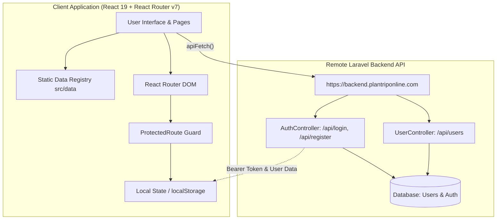
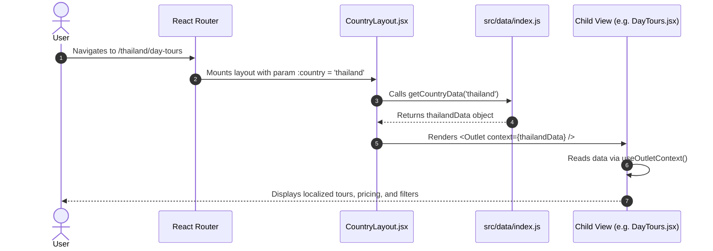
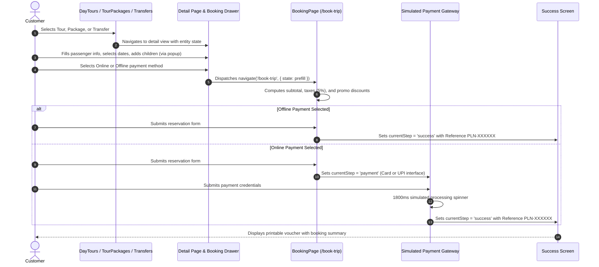
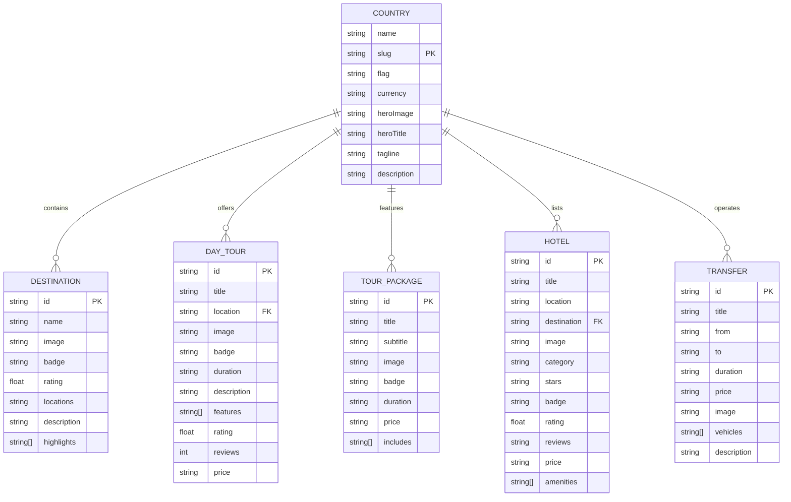
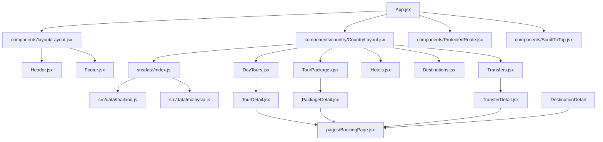

# PlanTripOnline (Frontend) — Project Context & Architectural Specification

> **Status:** Single Source of Truth for `PlanTripOnline-Frontend`  
> **Repository:** `e:\Eurasia Holidays\plantrip\PlanTripOnline-Frontend`  
> **Runtime Target:** React 19.2.8 | Vite 8.3.0 | React Router DOM 7.18.4  
> **Backend Integration:** Laravel REST API (`https://backend.plantriponline.com`)  
> **Document Generation Date:** October 2026  
> **Verification Level:** 100% verified against source code implementation  

---

## Table of Contents

1. [Project Overview](#1-project-overview)
2. [Project Goals and Core Business Concepts](#2-project-goals-and-core-business-concepts)
3. [Technology Stack and Dependencies](#3-technology-stack-and-dependencies)
4. [Repository Structure](#4-repository-structure)
5. [Application Architecture](#5-application-architecture)
6. [Frontend Pages and Navigation Routes](#6-frontend-pages-and-navigation-routes)
7. [Backend Routes and API Endpoint Inventory](#7-backend-routes-and-api-endpoint-inventory)
8. [Authentication, Middleware, and Permissions](#8-authentication-middleware-and-permissions)
9. [Complete Module and Functionality Inventory](#9-complete-module-and-functionality-inventory)
10. [Detailed Business Logic and Workflows](#10-detailed-business-logic-and-workflows)
11. [Controllers, Services, Models, and Important Functions](#11-controllers-services-models-and-important-functions)
12. [Database Schema and Relationships (Inferred Client Models)](#12-database-schema-and-relationships-inferred-client-models)
13. [External APIs and Third-Party Integrations](#13-external-apis-and-third-party-integrations)
14. [File Handling, Imports, Exports, and Reports](#14-file-handling-imports-exports-and-reports)
15. [Background Jobs, Events, and Scheduled Tasks](#15-background-jobs-events-and-scheduled-tasks)
16. [Configuration and Environment Variables](#16-configuration-and-environment-variables)
17. [Validation, Error Handling, and Security](#17-validation-error-handling-and-security)
18. [Testing and Test Coverage](#18-testing-and-test-coverage)
19. [Setup, Development, Build, and Deployment](#19-setup-development-build-and-deployment)
20. [Known Issues, TODOs, and Incomplete Features](#20-known-issues-todos-and-incomplete-features)
21. [Cross-Module Dependencies and Shared Components](#21-cross-module-dependencies-and-shared-components)
22. [Important Implementation Decisions and Constraints](#22-important-implementation-decisions-and-constraints)
23. [Evidence-Based File Reference Index](#23-evidence-based-file-reference-index)
24. [Documentation Coverage and Remaining Gaps](#24-documentation-coverage-and-remaining-gaps)
25. [Maintenance Instructions for Future Updates](#25-maintenance-instructions-for-future-updates)

---

## 1. Project Overview

**PlanTripOnline** is an online travel agency (OTA) web application specialized in tourism packages, day tours, private airport/city transfers, and hotel reservations across Southeast Asia and South Asia (principally **Thailand**, **Malaysia**, and **India**).

The repository `PlanTripOnline-Frontend` is a standalone, client-side Single Page Application (SPA) built using **React 19**, **Vite 8**, and **React Router DOM v7**. Content management across destinations, tours, hotels, and packages is currently powered by a client-side structured JavaScript data layer (`src/data/`), while user identity management, account registration, session authentication, and administrative user lists interface with a remote **Laravel** backend service hosted at `https://backend.plantriponline.com`.

### Operating Entities & Corporate Backing
- **Thailand Operations:** TIC Holidays Co., Ltd, Bangkok, Thailand
- **Malaysia Operations:** TIC Holidays Sdn. Bhd, Kuala Lumpur, Malaysia
- **India Operations:** Eurasia Holidays, Kochi, Kerala, India
- **Customer Support Contacts:** `info@plantriponline.com` | `+60 10 666 1747`

---

## 2. Project Goals and Core Business Concepts

### Primary Business Goals
1. **Catalog Showcase & Destination Discovery:** Present high-converting showcases for Southeast Asian destinations (Bangkok, Phuket, Chiang Mai, Kuala Lumpur, Penang, Langkawi, Cameron Highlands, etc.).
2. **Unified Tour & Transfer Booking Engine:** Guide users from high-level destination browsing through granular tour itineraries, passenger intake, interactive child age categorization, add-on selections, dynamic promo code discounts, and simulated checkout.
3. **Custom Itinerary Planning:** Capture specialized, bespoke travel requests via a structured enquiry form and custom package planning funnel.
4. **Bilingual/Multi-Currency Awareness:** Support localized representations of Malaysian Ringgit (`MYR` / `RM`), Thai Baht (`THB` / `฿`), and Indian Rupee (`INR` / `₹`).
5. **Administrative Visibility:** Provide role-gated administration to monitor platform users, review customer bookings, and access operational settings.

### Core Domain Entities
- **Country:** A top-level destination state containing regional destinations, curated day tours, accommodation listings, multi-day package itineraries, and private transport transfer routes.
- **Destination:** A distinct geographic hub (e.g., Pattaya, Langkawi) with associated sightseeing locations, tour counts, and linked activities.
- **Day Tour:** A single-day or half-day excursion with fixed duration, meeting location, rating, badges, inclusion features, and optional add-ons.
- **Tour Package:** An all-inclusive multi-day itinerary (e.g., 7D/6N) featuring hotel accommodations, domestic flight transfers, guided excursions, and meal plans.
- **Transfer:** A private vehicular ground transport option between transit hubs (airports) and city centers or resorts with vehicle selection (Sedan, SUV, Van, Minibus).
- **Hotel:** Curated lodging categorized by luxury tier (Luxury, Boutique, Upscale, Mid-Range) with star ratings and amenity lists.
- **Reservation / Booking:** A customer reservation record containing lead passenger contact details, travel dates, passenger headcounts (adults, children with individual ages), flight numbers, pickup/drop locations, vehicle selection, and calculated totals.

---

## 3. Technology Stack and Dependencies

### Core Framework and Build Tooling
- **React:** `^19.2.8` (Declarative UI rendering utilizing modern hooks `useMemo`, `useCallback`, `useRef`, `useState`, `useEffect`)
- **React DOM:** `^19.2.8` (Browser DOM bindings and rendering root)
- **Vite:** `^8.3.0` (Native ES module bundler, fast HMR server, Rollup-based production builder)
- **React Router DOM:** `^7.18.4` (Declarative client routing, nested layouts, outlet context passing, dynamic path parameters)
- **React Helmet Async:** `^3.0.0` (Asynchronous document head management for dynamic `<title>` and `<meta>` tags per page)

### Development Tooling & Linters
- **Oxlint:** `^1.81.0` (High-performance Rust-based JavaScript and JSX linter configured with React and OXC rule suites via `.oxlintrc.json`)
- **@vitejs/plugin-react:** `^6.1.1` (Babel/Oxc React Fast Refresh plugin)
- **TypeScript Type Definitions:** `@types/react` `^19.2.18`, `@types/react-dom` `^19.2.7` (Editor autocompletion)

### Styling Paradigms
1. **Vanilla External CSS:** Scoped component stylesheets imported globally or per module (`src/styles/home.css`, `header.css`, `footer.css`, `country.css`, `globals.css`).
2. **CSS Modules:** Class-scoped styles for administrative consoles (`src/pages/Dashboard.module.css`).
3. **Embedded JSX Style Tags:** Self-contained `<style>` blocks inside auth, booking, and detail components (`LoginPage.jsx`, `SignupPage.jsx`, `ForgotPasswordPage.jsx`, `EnquiryPage.jsx`, `BookingPage.jsx`, `TourDetail.jsx`, `PackageDetail.jsx`, `TransferDetail.jsx`).

---

## 4. Repository Structure

```
PlanTripOnline-Frontend/
├── .oxlintrc.json              # Oxlint linting rules configuration
├── DOCUMENTATION.md            # Legacy developer notes (partially superseded)
├── index.html                  # HTML entry point with Google Fonts (Poppins)
├── package.json                # Project dependencies and npm scripts
├── package-lock.json           # Exact dependency lockfile
├── README.md                   # Upstream template documentation
├── vite.config.js              # Vite configuration with React plugin
├── public/                     # Static assets served from web root
│   ├── favicon.svg             # Primary SVG site icon
│   ├── icons.svg               # SVG sprite definitions
│   └── assets/
│       └── favico.png          # High-resolution raster favicon (PNG)
├── src/                        # Application source code
│   ├── App.css                 # Global application root styling rules
│   ├── App.jsx                 # Master route definitions and route guards
│   ├── index.css               # Base CSS reset, typography, and body styling
│   ├── main.jsx                # SPA bootstrap with HelmetProvider & BrowserRouter
│   ├── assets/                 # Component-imported vector and raster assets
│   │   ├── hero.png            # Hero section graphic illustration
│   │   ├── react.svg           # React default asset
│   │   └── vite.svg            # Vite default asset
│   ├── components/             # Reusable UI components and layouts
│   │   ├── ProtectedRoute.jsx  # Route guard for authenticated & admin-only views
│   │   ├── ScrollToTop.jsx     # Route change listener resetting window scroll position
│   │   ├── admin/
│   │   │   └── UsersList.jsx   # Admin table managing registered user records via API
│   │   ├── country/            # Country-specific views and sub-module pages
│   │   │   ├── CountryLayout.jsx       # Context provider resolving country data by slug
│   │   │   ├── CustomizedPackages.jsx  # Custom trip landing showcase
│   │   │   ├── DayTours.jsx            # Day tours listing with location filter & search
│   │   │   ├── DestinationDetail.jsx   # Specific destination hub with linked tours/hotels
│   │   │   ├── Destinations.jsx        # Grid of regional destinations within a country
│   │   │   ├── HotelDetail.jsx         # Hotel detail view (placeholder)
│   │   │   ├── Hotels.jsx              # Hotel accommodations catalog with category filters
│   │   │   ├── PackageDetail.jsx       # Multi-day package detail, itinerary & drawer
│   │   │   ├── TourDetail.jsx          # Day tour detail view with booking drawer
│   │   │   ├── TourPackages.jsx        # Curated multi-day package itineraries catalog
│   │   │   ├── TransferDetail.jsx      # Private airport/intercity transfer booking form
│   │   │   └── Transfers.jsx           # Ground transfers catalog and vehicle filter
│   │   ├── home/               # Homepage constituent sections
│   │   │   ├── DestinationCarousel.jsx # 3D CSS transform destination carousel
│   │   │   ├── Hero.jsx                # Full-bleed hero banner with search bar
│   │   │   ├── PackagesGrid.jsx        # Country exploration cards and action triggers
│   │   │   └── ToursGrid.jsx           # Featured trending day tours grid
│   │   └── layout/             # Master layout scaffolding
│   │       ├── Footer.jsx      # Multi-column footer with office maps and links
│   │       ├── Header.jsx      # Responsive desktop/mobile navbar with country context
│   │       └── Layout.jsx      # Wrapper rendering Header, Outlet, and Footer
│   ├── config/
│   │   └── api.js              # Base API configuration (`apiFetch` wrapper)
│   ├── data/                   # Structured static data registry
│   │   ├── constants.js        # Deprecated legacy script (unreferenced)
│   │   ├── global.js           # Corporate identity, offices, social links, navigation
│   │   ├── homeData.js         # Carousel items, trending tours, and carousel physics
│   │   ├── index.js            # Country data lookup dispatcher (`getCountryData`)
│   │   ├── malaysia.js         # Malaysia dataset (tours, hotels, destinations, transfers)
│   │   └── thailand.js         # Thailand dataset (tours, hotels, destinations, transfers)
│   ├── pages/                  # Top-level route pages
│   │   ├── AboutPage.jsx       # Company informational page (placeholder)
│   │   ├── AdminDashboard.jsx  # Admin overview console with metric cards & chart shell
│   │   ├── Auth.module.css     # Deprecated CSS module for auth views (unreferenced)
│   │   ├── BookingPage.jsx     # Master 3-step checkout & payment gateway simulator
│   │   ├── ContactPage.jsx     # Contact information page (placeholder)
│   │   ├── CookiesPage.jsx     # Cookie policy page (placeholder)
│   │   ├── Dashboard.module.css# CSS module styling Admin & User dashboards
│   │   ├── DestinationToursPage.jsx # Tours list filtered by selected destination state
│   │   ├── EnquiryPage.jsx     # Comprehensive bespoke travel enquiry form
│   │   ├── FaqPage.jsx         # Frequently asked questions page (placeholder)
│   │   ├── ForgotPasswordPage.jsx # Password recovery view with interactive feedback
│   │   ├── HomePage.jsx        # Public homepage aggregating home sections
│   │   ├── LoginPage.jsx       # Account sign-in with interactive animated eye pupil
│   │   ├── NotFoundPage.jsx    # 404 fallback page (placeholder)
│   │   ├── PlanTripPage.jsx    # Tour overview, itinerary tabs & checkout dispatcher
│   │   ├── PrivacyPage.jsx     # Privacy policy statement (placeholder)
│   │   ├── SignupPage.jsx      # Account registration form with dual eye animation
│   │   ├── TermsPage.jsx       # Terms of service page (placeholder)
│   │   ├── UserDashboard.jsx   # Traveler profile dashboard shell
│   │   └── country/
│   │       └── CountryPage.jsx # Country landing hero, highlights, and entry points
│   └── styles/                 # Shared global CSS stylesheets
│       ├── country.css         # Styling rules for country layout components
│       ├── footer.css          # Complex mountain-ridge SVG and footer grid styling
│       ├── globals.css         # Reset, typography, color tokens, and container classes
│       ├── header.css          # Header navbar, mobile drawer, and dropdown styles
│       └── home.css            # Hero, tour card grids, carousel, and responsive rules
```

---

## 5. Application Architecture

### High-Level Architecture
PlanTripOnline functions as a client-side Single Page Application. It uses a **hybrid data strategy**:
- **Static Content Layer (`src/data/`):** Tourism inventory (destinations, day tours, packages, hotels, transfers) is bundled directly into the client build. This ensures zero latency for browsing and offline-ready responsiveness.
- **Dynamic Services Layer (`https://backend.plantriponline.com`):** User identity, authentication credentials, registration, and administrative records are managed through standard JSON REST endpoints over HTTPS.



### Context & Data Propagation Flow
Country sub-pages (`/:country/*`) are routed through `<CountryLayout />`, which extracts the `:country` URL parameter, queries the country registry via `getCountryData(slug)`, and provides the resolved country dataset down to child route components via React Router's `<Outlet context={data} />`.



---

## 6. Frontend Pages and Navigation Routes

Defined in [`src/App.jsx`](file:///e:/Eurasia%20Holidays/plantrip/PlanTripOnline-Frontend/src/App.jsx).

### Comprehensive Route Inventory Table

| HTTP Route / Path | Route Type | Component | Layout Wrapper | Auth / Permission | State / Query Input | Main Purpose & Result |
| :--- | :--- | :--- | :--- | :--- | :--- | :--- |
| `/` | Web (Index) | [`HomePage`](file:///e:/Eurasia%20Holidays/plantrip/PlanTripOnline-Frontend/src/pages/HomePage.jsx) | `<Layout>` (Header+Footer) | Public | None | Displays Hero banner, Popular Destinations 3D Carousel, Trending Day Tours, and Country Journey Cards. |
| `/login` | Web | [`LoginPage`](file:///e:/Eurasia%20Holidays/plantrip/PlanTripOnline-Frontend/src/pages/LoginPage.jsx) | None (Standalone) | Public | None | User authentication form with interactive eye pupil animation. Stores token and redirects to `/admin-dashboard` or `/user-dashboard`. |
| `/signup` | Web | [`SignupPage`](file:///e:/Eurasia%20Holidays/plantrip/PlanTripOnline-Frontend/src/pages/SignupPage.jsx) | None (Standalone) | Public | None | User account creation form with dual eye animations. Submits to `/api/register`. |
| `/forgot-password` | Web | [`ForgotPasswordPage`](file:///e:/Eurasia%20Holidays/plantrip/PlanTripOnline-Frontend/src/pages/ForgotPasswordPage.jsx) | None (Standalone) | Public | None | Password reset request form with simulated timeout and success confirmation. |
| `/enquiry` | Web | [`EnquiryPage`](file:///e:/Eurasia%20Holidays/plantrip/PlanTripOnline-Frontend/src/pages/EnquiryPage.jsx) | None (Standalone) | Public | None | Comprehensive travel inquiry form (dates, destination, passengers, travel style). |
| `/plan-trip` | Web | [`PlanTripPage`](file:///e:/Eurasia%20Holidays/plantrip/PlanTripOnline-Frontend/src/pages/PlanTripPage.jsx) | None (Standalone) | Public | `location.state`: `{ destination, country, image, description, highlights, badge, rating }` | Multi-tab tour/destination review page (Overview, Inclusions, Itinerary, Reviews). Dispatches to `/book-trip`. |
| `/destination-tours` | Web | [`DestinationToursPage`](file:///e:/Eurasia%20Holidays/plantrip/PlanTripOnline-Frontend/src/pages/DestinationToursPage.jsx) | None (Standalone) | Public | `location.state`: `{ destination, country, countrySlug, image }` | Lists all day tours associated with a specific destination name. Dispatches to `/plan-trip`. |
| `/book-trip` | Web | [`BookingPage`](file:///e:/Eurasia%20Holidays/plantrip/PlanTripOnline-Frontend/src/pages/BookingPage.jsx) | None (Standalone) | Public | `location.state`: `{ destination, country, image, price, rating, prefill, paymentMethod }` | Master reservation checkout engine: Contact & Passenger form, dynamic tax/promo pricing, simulated card/UPI gateway, and printable booking voucher. |
| `/admin-dashboard/*` | Web (Nested) | [`AdminDashboard`](file:///e:/Eurasia%20Holidays/plantrip/PlanTripOnline-Frontend/src/pages/AdminDashboard.jsx) | Protected (Standalone) | `adminOnly` (`admin@plantriponline.com`) | None | Admin control center. Displays operational KPI cards, weekly revenue bar chart, recent booking list, and mounts user management at `/users`. |
| `/admin-dashboard/users` | Web | [`UsersList`](file:///e:/Eurasia%20Holidays/plantrip/PlanTripOnline-Frontend/src/components/admin/UsersList.jsx) | Protected (`AdminDashboard`) | `adminOnly` | None | Live user management console querying `/api/users` with search, role filters, and status badges. |
| `/user-dashboard/*` | Web | [`UserDashboard`](file:///e:/Eurasia%20Holidays/plantrip/PlanTripOnline-Frontend/src/pages/UserDashboard.jsx) | Protected (Standalone) | `userOnly` (Non-admin token) | None | Traveler personal portal showing upcoming/past trip counters and navigation links. |
| `/about` | Web | [`AboutPage`](file:///e:/Eurasia%20Holidays/plantrip/PlanTripOnline-Frontend/src/pages/AboutPage.jsx) | `<Layout>` | Public | None | Placeholder company profile page. |
| `/contact` | Web | [`ContactPage`](file:///e:/Eurasia%20Holidays/plantrip/PlanTripOnline-Frontend/src/pages/ContactPage.jsx) | `<Layout>` | Public | None | Placeholder contact page. |
| `/faq` | Web | [`FaqPage`](file:///e:/Eurasia%20Holidays/plantrip/PlanTripOnline-Frontend/src/pages/FaqPage.jsx) | `<Layout>` | Public | None | Placeholder FAQ page. |
| `/privacy` | Web | [`PrivacyPage`](file:///e:/Eurasia%20Holidays/plantrip/PlanTripOnline-Frontend/src/pages/PrivacyPage.jsx) | `<Layout>` | Public | None | Placeholder privacy policy page. |
| `/terms` | Web | [`TermsPage`](file:///e:/Eurasia%20Holidays/plantrip/PlanTripOnline-Frontend/src/pages/TermsPage.jsx) | `<Layout>` | Public | None | Placeholder terms of service page. |
| `/cookies` | Web | [`CookiesPage`](file:///e:/Eurasia%20Holidays/plantrip/PlanTripOnline-Frontend/src/pages/CookiesPage.jsx) | `<Layout>` | Public | None | Placeholder cookie policy page. |
| `/:country` | Web (Index) | [`CountryPage`](file:///e:/Eurasia%20Holidays/plantrip/PlanTripOnline-Frontend/src/pages/country/CountryPage.jsx) | `<Layout>` > `<CountryLayout>` | Public | URL Param `:country` | Country landing page displaying country hero, top destinations, featured day tours, and tour packages. |
| `/:country/day-tours` | Web | [`DayTours`](file:///e:/Eurasia%20Holidays/plantrip/PlanTripOnline-Frontend/src/components/country/DayTours.jsx) | `<Layout>` > `<CountryLayout>` | Public | URL Param `:country` | Day tours catalog with location filtering, date/guest inputs, wishlist toggles, and direct links to tour detail. |
| `/:country/tour-packages` | Web | [`TourPackages`](file:///e:/Eurasia%20Holidays/plantrip/PlanTripOnline-Frontend/src/components/country/TourPackages.jsx) | `<Layout>` > `<CountryLayout>` | Public | URL Param `:country` | Multi-day tour packages catalog with live search filter, featured highlight package, and inclusions summary. |
| `/:country/hotels` | Web | [`Hotels`](file:///e:/Eurasia%20Holidays/plantrip/PlanTripOnline-Frontend/src/components/country/Hotels.jsx) | `<Layout>` > `<CountryLayout>` | Public | URL Param `:country` | Hotel accommodations catalog featuring search, check-in/out dates, guest counts, category filter tabs, and enquiry CTAs. |
| `/:country/hotels/:hotelSlug` | Web | [`HotelDetail`](file:///e:/Eurasia%20Holidays/plantrip/PlanTripOnline-Frontend/src/components/country/HotelDetail.jsx) | `<Layout>` > `<CountryLayout>` | Public | URL Params `:country`, `:hotelSlug` | Individual hotel detail page (placeholder). |
| `/:country/destinations` | Web | [`Destinations`](file:///e:/Eurasia%20Holidays/plantrip/PlanTripOnline-Frontend/src/components/country/Destinations.jsx) | `<Layout>` > `<CountryLayout>` | Public | URL Param `:country` | Destination cards showcase with search bar filtering by name, highlights, or locations. |
| `/:country/destinations/:destSlug` | Web | [`DestinationDetail`](file:///e:/Eurasia%20Holidays/plantrip/PlanTripOnline-Frontend/src/components/country/DestinationDetail.jsx) | `<Layout>` > `<CountryLayout>` | Public | URL Params `:country`, `:destSlug` | Dedicated regional destination page displaying destination stats, linked day tours, matching hotels, and packages. |
| `/:country/transfers` | Web | [`Transfers`](file:///e:/Eurasia%20Holidays/plantrip/PlanTripOnline-Frontend/src/components/country/Transfers.jsx) | `<Layout>` > `<CountryLayout>` | Public | URL Param `:country` | Private airport/intercity transport catalog with vehicle options, duration estimates, and search filtering. |
| `/:country/transfers/:transferSlug` | Web | [`TransferDetail`](file:///e:/Eurasia%20Holidays/plantrip/PlanTripOnline-Frontend/src/components/country/TransferDetail.jsx) | `<Layout>` > `<CountryLayout>` | Public | URL Params `:country`, `:transferSlug`, `location.state` | Interactive transfer booking form: pickup/drop selection, vehicle fleet upgrades (Sedan/SUV/Van/Minibus), flight numbers, and instant receipt generation. |
| `/:country/customized-packages` | Web | [`CustomizedPackages`](file:///e:/Eurasia%20Holidays/plantrip/PlanTripOnline-Frontend/src/components/country/CustomizedPackages.jsx) | `<Layout>` > `<CountryLayout>` | Public | URL Param `:country` | Custom travel itinerary landing page outlining a 3-step personalization process with direct link to `/enquiry`. |
| `/:country/tours/:tourSlug` | Web | [`TourDetail`](file:///e:/Eurasia%20Holidays/plantrip/PlanTripOnline-Frontend/src/components/country/TourDetail.jsx) | `<Layout>` > `<CountryLayout>` | Public | URL Params `:country`, `:tourSlug`, `location.state` | In-depth tour details view with itinerary timeline, inclusions/exclusions, customer reviews, booking drawer, child age modal, and add-ons. |
| `/:country/package/:packageSlug` | Web | [`PackageDetail`](file:///e:/Eurasia%20Holidays/plantrip/PlanTripOnline-Frontend/src/components/country/PackageDetail.jsx) | `<Layout>` > `<CountryLayout>` | Public | URL Params `:country`, `:packageSlug`, `location.state` | Multi-day package details view with daily itinerary, room/hotel preferences, flight fields, booking drawer, and dispatch to `/book-trip`. |
| `*` | Web (Fallback) | [`NotFoundPage`](file:///e:/Eurasia%20Holidays/plantrip/PlanTripOnline-Frontend/src/pages/NotFoundPage.jsx) | `<Layout>` | Public | Any unmatched URL | 404 Not Found error screen. |

---

## 7. Backend Routes and API Endpoint Inventory

The frontend interfaces with the remote Laravel backend at base URL `https://backend.plantriponline.com` using the utility [`apiFetch`](file:///e:/Eurasia%20Holidays/plantrip/PlanTripOnline-Frontend/src/config/api.js).

### API Endpoint Inventory Table

| HTTP Method & Endpoint | Consuming File | Request Headers | Request Body Parameters | Validation & Payload Rules | Expected Response Payload | Error Handling & Status Codes |
| :--- | :--- | :--- | :--- | :--- | :--- | :--- |
| `POST /api/login` | [`LoginPage.jsx`](file:///e:/Eurasia%20Holidays/plantrip/PlanTripOnline-Frontend/src/pages/LoginPage.jsx#L52) | `Content-Type: application/json`<br>`Accept: application/json` | `{ "email": string, "password": string }` | - `email`: Required valid email (or shorthand `'admin'` automatically converted to `'admin@plantriponline.com'`).<br>- `password`: Required. | `200 OK`<br>`{ "token": "string", "user": { "name": "string", "email": "string" } }` | `401 Unauthorized` / `422 Unprocessable`: Sets `error` state to `data.message || 'Login failed...'`. Network error sets server connectivity warning. |
| `POST /api/register` | [`SignupPage.jsx`](file:///e:/Eurasia%20Holidays/plantrip/PlanTripOnline-Frontend/src/pages/SignupPage.jsx#L76) | `Content-Type: application/json`<br>`Accept: application/json` | `{ "name": string, "email": string, "country": string, "phone": string, "password": string, "password_confirmation": string }` | - Client checks `password === password_confirmation`.<br>- All fields sent to backend. Terms must be accepted client-side. | `200 OK` or `201 Created`<br>`{ "token": "string", "user": { "name": "string", "email": "string" } }` | `422 Unprocessable Entity`: Parses Laravel error bag `data.errors`, extracting `Object.values(data.errors)[0][0]`. Falls back to `data.message`. |
| `GET /api/users` | [`UsersList.jsx`](file:///e:/Eurasia%20Holidays/plantrip/PlanTripOnline-Frontend/src/components/admin/UsersList.jsx#L17) | `Content-Type: application/json`<br>`Accept: application/json`<br>`Authorization: Bearer <token>` | None (GET query) | Requires Bearer token stored in `localStorage.getItem('token')`. | `200 OK`<br>`{ "users": [ { "id": number/string, "name": string, "email": string, "role": "Admin"|"User", "status": "Active"|"Inactive", "date": string } ] }` | `401 Unauthorized` / `403 Forbidden` / `500 Server Error`: Throws error `Error <status>: Failed to fetch users`. Displays error banner with retry option. |

---

## 8. Authentication, Middleware, and Permissions

### Architecture & Storage Strategy
Authentication state is managed on the client side using browser `localStorage`. No cookie-based sessions or third-party auth SDKs (Firebase/Auth0) are used.

```mermaid
flowchart LR
    Login[LoginPage / SignupPage] -->|Receives Token & User Info| Storage[(localStorage)]
    Storage -->|token| Guard[ProtectedRoute.jsx]
    Storage -->|userEmail| Guard
    Storage -->|token & userName| Header[Header.jsx Profile Avatar]
    Guard -->|Valid admin token| AdminDash[/admin-dashboard]
    Guard -->|Valid user token| UserDash[/user-dashboard]
    Guard -->|No token| RedirectLogin[/login]
```

### LocalStorage Keys
1. `token`: JWT or Sanctum bearer token string.
2. `userName`: Display name of the authenticated user (e.g., `"Admin"`, `"John Doe"`).
3. `userEmail`: Email address of the user (e.g., `"admin@plantriponline.com"`).

### Role Determination & Guard Logic ([`ProtectedRoute.jsx`](file:///e:/Eurasia%20Holidays/plantrip/PlanTripOnline-Frontend/src/components/ProtectedRoute.jsx))
- **Admin Email Identifier:** Hardcoded check `userEmail === 'admin@plantriponline.com'`.
- **Admin Shorthand Bypass:** In [`LoginPage.jsx`](file:///e:/Eurasia%20Holidays/plantrip/PlanTripOnline-Frontend/src/pages/LoginPage.jsx#L47), typing `"admin"` in the login field maps directly to `"admin@plantriponline.com"`.
- **Guard Rules:**
  - If `!token` $\rightarrow$ Redirect to `/login` with `replace`.
  - If `adminOnly` is set and user is not admin $\rightarrow$ Redirect to `/user-dashboard`.
  - If `userOnly` is set and user is admin $\rightarrow$ Redirect to `/admin-dashboard`.
  - Otherwise $\rightarrow$ Render wrapped `children`.

### Logout Lifecycles
- [`Header.jsx`](file:///e:/Eurasia%20Holidays/plantrip/PlanTripOnline-Frontend/src/components/layout/Header.jsx#L59): Removes `token` and `userName`, updates local state, navigates to `/`.
- [`AdminDashboard.jsx`](file:///e:/Eurasia%20Holidays/plantrip/PlanTripOnline-Frontend/src/pages/AdminDashboard.jsx#L11): Removes `token` and `userName`, navigates to `/login`.
- [`UserDashboard.jsx`](file:///e:/Eurasia%20Holidays/plantrip/PlanTripOnline-Frontend/src/pages/UserDashboard.jsx#L8): Removes `token`, navigates to `/login`.
- *(Note: `userEmail` is currently retained on logout in some handlers unless manually cleared).*

---

## 9. Complete Module and Functionality Inventory

### 1. Home Module
- **Files:** [`HomePage.jsx`](file:///e:/Eurasia%20Holidays/plantrip/PlanTripOnline-Frontend/src/pages/HomePage.jsx), [`Hero.jsx`](file:///e:/Eurasia%20Holidays/plantrip/PlanTripOnline-Frontend/src/components/home/Hero.jsx), [`DestinationCarousel.jsx`](file:///e:/Eurasia%20Holidays/plantrip/PlanTripOnline-Frontend/src/components/home/DestinationCarousel.jsx), [`ToursGrid.jsx`](file:///e:/Eurasia%20Holidays/plantrip/PlanTripOnline-Frontend/src/components/home/ToursGrid.jsx), [`PackagesGrid.jsx`](file:///e:/Eurasia%20Holidays/plantrip/PlanTripOnline-Frontend/src/components/home/PackagesGrid.jsx).
- **Functionality:** 
  - Dynamic hero search checking user input against country names; navigates to `/:country/destinations` on match.
  - Interactive 3D CSS perspective carousel with autoplay (5000ms), card click navigation, left/right arrows, and dot indicators.
  - Trending day tours cards displaying ratings, price, country badge, and imagery.
  - Quick action buttons routing directly to `/:country/day-tours`, `/:country/tour-packages`, and `/:country/customized-packages`.
- **Status:** Fully implemented.

### 2. Country Discovery Hub
- **Files:** [`CountryLayout.jsx`](file:///e:/Eurasia%20Holidays/plantrip/PlanTripOnline-Frontend/src/components/country/CountryLayout.jsx), [`CountryPage.jsx`](file:///e:/Eurasia%20Holidays/plantrip/PlanTripOnline-Frontend/src/pages/country/CountryPage.jsx).
- **Functionality:** Resolves country data object from `getCountryData(country)`. Displays hero, quick in-page navigation anchors, top destinations grid, day tours teaser (up to 6 tours), and tour packages grid (up to 4 packages).
- **Status:** Fully implemented for `thailand` and `malaysia`. Fallback empty shell for `india`.

### 3. Day Tours Catalog & Details
- **Files:** [`DayTours.jsx`](file:///e:/Eurasia%20Holidays/plantrip/PlanTripOnline-Frontend/src/components/country/DayTours.jsx), [`TourDetail.jsx`](file:///e:/Eurasia%20Holidays/plantrip/PlanTripOnline-Frontend/src/components/country/TourDetail.jsx).
- **Functionality:**
  - `DayTours.jsx`: Location dropdown filter, date picker, travelers input, wishlist toggling, and trust badges strip.
  - `TourDetail.jsx`: Dynamic tour enrichment (`enrichTour`), interactive tabs (Overview, Inclusions, Itinerary, Reviews), booking sidebar/drawer, adults counter, child age popup, optional addons checklist (`Photographer`, `Snorkeling gear`, `Lunch upgrade`), promo code input (`PLANTRIP10`), passenger intake form.
  - Dispatches to `/book-trip` with prefilled state.
- **Status:** Fully implemented.

### 4. Multi-Day Tour Packages
- **Files:** [`TourPackages.jsx`](file:///e:/Eurasia%20Holidays/plantrip/PlanTripOnline-Frontend/src/components/country/TourPackages.jsx), [`PackageDetail.jsx`](file:///e:/Eurasia%20Holidays/plantrip/PlanTripOnline-Frontend/src/components/country/PackageDetail.jsx).
- **Functionality:**
  - `TourPackages.jsx`: Real-time text search filter across package title, subtitle, duration, and included items. Hero highlight card and responsive package grid.
  - `PackageDetail.jsx`: Day-by-day itinerary timeline, inclusions/exclusions tags, verified review testimonials, booking drawer with flight arrival/departure inputs, airport selections, room type dropdown, hotel tier preferences, child age modal, and transition to `/book-trip`.
- **Status:** Fully implemented.

### 5. Destinations & Destination Tours
- **Files:** [`Destinations.jsx`](file:///e:/Eurasia%20Holidays/plantrip/PlanTripOnline-Frontend/src/components/country/Destinations.jsx), [`DestinationDetail.jsx`](file:///e:/Eurasia%20Holidays/plantrip/PlanTripOnline-Frontend/src/components/country/DestinationDetail.jsx), [`DestinationToursPage.jsx`](file:///e:/Eurasia%20Holidays/plantrip/PlanTripOnline-Frontend/src/pages/DestinationToursPage.jsx), [`PlanTripPage.jsx`](file:///e:/Eurasia%20Holidays/plantrip/PlanTripOnline-Frontend/src/pages/PlanTripPage.jsx).
- **Functionality:**
  - Displays regional destination cards with highlight tags and tour counts.
  - `DestinationDetail.jsx` filters day tours, hotels, and packages belonging to that specific destination.
  - `DestinationToursPage.jsx` dynamically loads tours matching destination name; forwards selected tour to `PlanTripPage.jsx`.
  - `PlanTripPage.jsx` provides an interactive 4-tab itinerary breakdown before committing to `/book-trip`.
- **Status:** Fully implemented.

### 6. Private Transfers & Ground Transport
- **Files:** [`Transfers.jsx`](file:///e:/Eurasia%20Holidays/plantrip/PlanTripOnline-Frontend/src/components/country/Transfers.jsx), [`TransferDetail.jsx`](file:///e:/Eurasia%20Holidays/plantrip/PlanTripOnline-Frontend/src/components/country/TransferDetail.jsx).
- **Functionality:**
  - `Transfers.jsx`: Displays airport-to-city and intercity routes with vehicle chips, travel duration, and search filtering.
  - `TransferDetail.jsx`: Start/End destination selection, predefined pickup locations per city (e.g., Suvarnabhumi Airport, Sukhumvit), vehicle selection (Sedan: +$0, SUV: +$15, Van: +$25, Minibus: +$40), flight details, airport representative meet-and-greet option, offline receipt generation, and online checkout forwarding.
- **Status:** Fully implemented.

### 7. Hotel Accommodations
- **Files:** [`Hotels.jsx`](file:///e:/Eurasia%20Holidays/plantrip/PlanTripOnline-Frontend/src/components/country/Hotels.jsx), [`HotelDetail.jsx`](file:///e:/Eurasia%20Holidays/plantrip/PlanTripOnline-Frontend/src/components/country/HotelDetail.jsx).
- **Functionality:**
  - `Hotels.jsx`: Search by hotel name/location/amenity, check-in and check-out dates, guest selector, category filter buttons (`luxury`, `boutique`, `upscale`, `mid-range`), favorites toggle, and direct "Enquire" button routing to `/enquiry`.
  - `HotelDetail.jsx`: Placeholder screen.
- **Status:** `Hotels.jsx` is fully implemented; `HotelDetail.jsx` is a placeholder.

### 8. Master Reservation & Payment Engine
- **Files:** [`BookingPage.jsx`](file:///e:/Eurasia%20Holidays/plantrip/PlanTripOnline-Frontend/src/pages/BookingPage.jsx).
- **Functionality:**
  - 3-step checkout workflow: `form` $\rightarrow$ `payment` $\rightarrow$ `success`.
  - Offline payment mode triggers immediate booking confirmation without payment gate.
  - Interactive child age popup validating ages between 0 and 17.
  - Live price recalculation: base rate per adult ($120), child ($70), 5% tax, and promo code deduction ($25 off with `PLANTRIP10` or `WELCOME`).
  - Interactive simulated payment gateway supporting Credit/Debit Card and UPI with loading animation and reference ID generation (`PLN-XXXXXX`).
  - Printable reservation confirmation voucher.
- **Status:** Fully implemented (client-side simulation).

### 9. Custom Package Builder & Enquiry
- **Files:** [`CustomizedPackages.jsx`](file:///e:/Eurasia%20Holidays/plantrip/PlanTripOnline-Frontend/src/components/country/CustomizedPackages.jsx), [`EnquiryPage.jsx`](file:///e:/Eurasia%20Holidays/plantrip/PlanTripOnline-Frontend/src/pages/EnquiryPage.jsx).
- **Functionality:**
  - Value proposition landing page with 3-step planning explanation leading to enquiry.
  - Comprehensive inquiry intake form (contact details, travel destination, travel type, start date, trip duration, message).
- **Status:** Fully implemented UI; submission currently uses a simulated timeout alert.

### 10. User & Admin Dashboards
- **Files:** [`AdminDashboard.jsx`](file:///e:/Eurasia%20Holidays/plantrip/PlanTripOnline-Frontend/src/pages/AdminDashboard.jsx), [`UsersList.jsx`](file:///e:/Eurasia%20Holidays/plantrip/PlanTripOnline-Frontend/src/components/admin/UsersList.jsx), [`UserDashboard.jsx`](file:///e:/Eurasia%20Holidays/plantrip/PlanTripOnline-Frontend/src/pages/UserDashboard.jsx).
- **Functionality:**
  - `AdminDashboard.jsx`: Metrics cards (Users, Bookings, Revenue, Packages), mock revenue bar chart, recent bookings table shell, and nested router mounting `UsersList`.
  - `UsersList.jsx`: Live data retrieval via `GET /api/users` with Bearer auth, text search across name/email, role filtering (`All`, `Admin`, `User`), and status tags.
  - `UserDashboard.jsx`: Traveler dashboard shell showing trip status indicators.
- **Status:** User list is integrated with live API; metrics, charts, and bookings tables are static UI shells.

---

## 10. Detailed Business Logic and Workflows

### Checkout & Reservation Workflow
The booking lifecycle seamlessly connects multiple entry points into [`BookingPage.jsx`](file:///e:/Eurasia%20Holidays/plantrip/PlanTripOnline-Frontend/src/pages/BookingPage.jsx).



### Pricing Calculation Rules

#### 1. In [`BookingPage.jsx`](file:///e:/Eurasia%20Holidays/plantrip/PlanTripOnline-Frontend/src/pages/BookingPage.jsx#L81-L92):
$$\text{Subtotal} = (\text{Adults} \times 120) + (\text{Children} \times 70)$$
$$\text{Discount} = 25 \quad (\text{if promo code is } \texttt{PLANTRIP10} \text{ or } \texttt{WELCOME}, \text{ else } 0)$$
$$\text{Taxes} = \text{round}\Big((\text{Subtotal} - \text{Discount}) \times 0.05\Big)$$
$$\text{Total} = \max(0, \, \text{Subtotal} - \text{Discount} + \text{Taxes})$$

#### 2. In [`TourDetail.jsx`](file:///e:/Eurasia%20Holidays/plantrip/PlanTripOnline-Frontend/src/components/country/TourDetail.jsx#L108-L121):
$$\text{Base Total} = (\text{Adults} \times \text{adultPrice}) + (\text{Children} \times \text{childPrice})$$
$$\text{Addon Total} = \sum \text{selectedAddonPrices} \times (\text{Adults} + \text{Children})$$
$$\text{Promo Discount} = 10\% \text{ of Subtotal} \quad (\text{if promo applied})$$

#### 3. In [`TransferDetail.jsx`](file:///e:/Eurasia%20Holidays/plantrip/PlanTripOnline-Frontend/src/components/country/TransferDetail.jsx#L92-L97):
$$\text{Price Per Person} = \text{Base Price} + \text{Vehicle Extra} \quad (\text{Sedan: } \$0, \, \text{SUV: } \$15, \, \text{Van: } \$25, \, \text{Minibus: } \$40)$$
$$\text{Subtotal} = (\text{Price Per Person} \times \text{Adults}) + (\text{Price Per Person} \times 0.5 \times \text{Children})$$
$$\text{Discount} = 10\% \text{ of Subtotal} \quad (\text{if promo applied})$$

### Child Age Modal Validation
Across `TourDetail.jsx`, `PackageDetail.jsx`, `TransferDetail.jsx`, and `BookingPage.jsx`, clicking "Add Child" triggers `<ChildAgePopup />`. The user must input an age between `0` and `17` inclusive. The child is stored as an object `{ age: number }` in the `kids` state array, ensuring transparent family travel pricing.

---

## 11. Controllers, Services, Models, and Important Functions

### Key Client Services & Utilities

#### [`apiFetch(endpoint, options)`](file:///e:/Eurasia%20Holidays/plantrip/PlanTripOnline-Frontend/src/config/api.js#L10)
- **Signature:** `(endpoint: string, options?: RequestInit) => Promise<Response>`
- **Role:** Centralized wrapper prepending `https://backend.plantriponline.com` and injecting default headers (`Content-Type: application/json`, `Accept: application/json`).

#### [`getCountryData(slug)`](file:///e:/Eurasia%20Holidays/plantrip/PlanTripOnline-Frontend/src/data/index.js#L29)
- **Signature:** `(slug: string) => CountryDataObject | null`
- **Role:** Maps route slugs (`'thailand'`, `'malaysia'`, `'india'`) to structured dataset objects.

#### [`formatCurrency(amount, currency)`](file:///e:/Eurasia%20Holidays/plantrip/PlanTripOnline-Frontend/src/data/global.js#L69)
- **Signature:** `(amount: number|string, currency: string) => string`
- **Role:** Converts raw monetary amounts to formatted currency strings with appropriate symbol prefixes (`RM`, `฿`, `₹`).

#### [`enrichTour(tour)`](file:///e:/Eurasia%20Holidays/plantrip/PlanTripOnline-Frontend/src/components/country/TourDetail.jsx#L41) & [`enrichPkg(pkg)`](file:///e:/Eurasia%20Holidays/plantrip/PlanTripOnline-Frontend/src/components/country/PackageDetail.jsx#L42)
- **Role:** Fallback hydration utilities ensuring that basic tour and package models possess complete arrays for inclusions, exclusions, daily itinerary steps, and customer review testimonials.

---

## 12. Database Schema and Relationships (Inferred Client Models)

Because this repository contains the client frontend only, no direct SQL migrations, Eloquent models, or database seeders exist in this codebase. However, based on the backend API contracts and client state objects, the remote database schemas are structured as follows:

### 1. Inferred `users` Table (Backend)
```
Table: users
├── id (PK, unsigned bigint)
├── name (varchar)
├── email (varchar, unique)
├── password (varchar, hashed)
├── country (varchar, nullable)
├── phone (varchar, nullable)
├── role (enum: 'Admin', 'User' / varchar, default 'User')
├── status (enum: 'Active', 'Inactive' / varchar, default 'Active')
├── email_verified_at (timestamp, nullable)
├── created_at (timestamp)
└── updated_at (timestamp)
```

### 2. Client Static Data Entity Models (`src/data/`)



---

## 13. External APIs and Third-Party Integrations

### Remote REST Services
- **Endpoint:** `https://backend.plantriponline.com`
- **Protocol:** HTTPS REST (JSON request and response bodies)
- **CORS Requirements:** Configured on the Laravel backend to accept requests from frontend origin (`http://localhost:5173` in local development and production domain).

### Content Delivery & Media Assets
- **Unsplash Images:** Hero banners, destination photography, and hotel showcases (`images.unsplash.com`).
- **OTA Asset CDNs:** Activity thumbnails and theme park photography from Klook (`res.klook.com`), KKday (`image.kkday.com`), Agoda (`pix10.agoda.net`), Tripadvisor (`dynamic-media.tacdn.com`), Booking.com (`q-xx.bstatic.com`).
- **Google Maps Embeds:** High-accuracy iframe embeds in [`Footer.jsx`](file:///e:/Eurasia%20Holidays/plantrip/PlanTripOnline-Frontend/src/components/layout/Footer.jsx) showcasing physical offices:
  - Bangkok Office: TIC Holidays Co., Ltd (`13.7303298, 100.583403`)
  - Kuala Lumpur Office: TIC Holidays Sdn. Bhd (`3.1611607, 101.741607`)
  - Kochi Office: Eurasia Holidays (`10.0272519, 76.3088995`)

---

## 14. File Handling, Imports, Exports, and Reports

### Static Assets Handling
- Vite serves static favicon and icon assets from `public/`.
- Embedded graphics in `src/assets/` (`hero.png`, `react.svg`, `vite.svg`) are bundled via Vite's asset pipeline.

### Document & Voucher Reports
- In [`BookingPage.jsx`](file:///e:/Eurasia%20Holidays/plantrip/PlanTripOnline-Frontend/src/pages/BookingPage.jsx), upon booking completion (Step 3: `success`), an interactive action allows the customer to invoke `window.print()`, formatting the on-screen booking confirmation voucher into a clean, physical or PDF reservation receipt.

---

## 15. Background Jobs, Events, and Scheduled Tasks

### Client-Side Scheduled Tasks & Timers
1. **Carousel Autoplay Interval:** [`DestinationCarousel.jsx`](file:///e:/Eurasia%20Holidays/plantrip/PlanTripOnline-Frontend/src/components/home/DestinationCarousel.jsx#L46) registers a `setInterval` triggering `nextSlide` every 5000ms. Cleared on component unmount via cleanup function.
2. **Interactive Eye Tracking Animation:**
   - [`LoginPage.jsx`](file:///e:/Eurasia%20Holidays/plantrip/PlanTripOnline-Frontend/src/pages/LoginPage.jsx#L17) & [`SignupPage.jsx`](file:///e:/Eurasia%20Holidays/plantrip/PlanTripOnline-Frontend/src/pages/SignupPage.jsx#L24): Register global `mousemove` event listeners when password visibility is active. Computes angle ($\text{atan2}$) and relative pupil distance, dynamically styling SVG pupils via CSS transforms. Event listeners are destroyed on unmount or toggle off.
3. **Simulated Async Response Timers:**
   - `ForgotPasswordPage.jsx`: 1500ms `setTimeout` simulating server password dispatch.
   - `EnquiryPage.jsx`: 1500ms `setTimeout` simulating form intake processing.
   - `BookingPage.jsx`: 1800ms `setTimeout` simulating payment gateway authorization.

---

## 16. Configuration and Environment Variables

### Configuration Files
- **[`src/config/api.js`](file:///e:/Eurasia%20Holidays/plantrip/PlanTripOnline-Frontend/src/config/api.js):** Defines the active `API_BASE_URL` (`https://backend.plantriponline.com`).
- **[`vite.config.js`](file:///e:/Eurasia%20Holidays/plantrip/PlanTripOnline-Frontend/vite.config.js):** Configures Vite runtime plugins with `@vitejs/plugin-react`.
- **[`.oxlintrc.json`](file:///e:/Eurasia%20Holidays/plantrip/PlanTripOnline-Frontend/.oxlintrc.json):** Oxlint rules specification enforcing `react/rules-of-hooks` and `react/only-export-components`.

### Environment Variables
Currently, the backend URL is declared as an exported constant in `src/config/api.js`. When deploying across multiple environments (staging, production), it is recommended to bind this to Vite environment variables:
- `VITE_API_BASE_URL`: Optional variable to override backend API origin without modifying source files.

---

## 17. Validation, Error Handling, and Security

### Form Validations
1. **Client-Side Auth Validation:**
   - [`SignupPage.jsx`](file:///e:/Eurasia%20Holidays/plantrip/PlanTripOnline-Frontend/src/pages/SignupPage.jsx#L60): Verifies that `password === password_confirmation` before dispatch.
   - Parses backend 422 validation bags from Laravel, displaying specific field errors.
2. **Booking & Passenger Validation:**
   - [`TourDetail.jsx`](file:///e:/Eurasia%20Holidays/plantrip/PlanTripOnline-Frontend/src/components/country/TourDetail.jsx#L123), [`PackageDetail.jsx`](file:///e:/Eurasia%20Holidays/plantrip/PlanTripOnline-Frontend/src/components/country/PackageDetail.jsx#L111), [`TransferDetail.jsx`](file:///e:/Eurasia%20Holidays/plantrip/PlanTripOnline-Frontend/src/components/country/TransferDetail.jsx#L99): Validate presence of `firstName`, `lastName`, valid email pattern (`\S+@\S+\.\S+`), phone/whatsapp numbers, and travel dates before proceeding.

### Security Controls
- **Cross-Site Scripting (XSS):** React JSX escapes variables by default, neutralizing raw HTML injection.
- **Credential Storage:** User tokens are isolated in `localStorage`. Sensitive password fields are never stored or logged.
- **Route Guarding:** [`ProtectedRoute.jsx`](file:///e:/Eurasia%20Holidays/plantrip/PlanTripOnline-Frontend/src/components/ProtectedRoute.jsx) protects administrative screens from unauthorized direct URL access.

---

## 18. Testing and Test Coverage

### Linting Coverage
- Executed via `npm run lint` (`oxlint`).
- **Results:** 0 errors, 58 warnings across 50 files. Warnings primarily reflect React purity checks (e.g., calling `new Date()` during render) and unused imports.

### Build Verification
- Executed via `npm run build` (`vite build`).
- **Results:** Production build compiles cleanly in ~3.76 seconds, producing optimized JavaScript (`dist/assets/index-*.js`, 723 kB / 175 kB gzip) and CSS (`dist/assets/index-*.css`, 28 kB).

### Implementation Gaps in Automated Testing
- No unit test harness (Vitest / Jest) or end-to-end test framework (Playwright / Cypress) is currently installed in `package.json`. Tests should be introduced for critical pricing calculations and route protection.

---

## 19. Setup, Development, Build, and Deployment

### System Prerequisites
- **Node.js:** v18.0.0 or higher
- **npm:** v9.0.0 or higher

### Local Development Lifecycle
```bash
# 1. Install dependencies
npm install

# 2. Launch Vite development server with HMR
npm run dev
# Server accessible at http://localhost:5173

# 3. Execute Oxlint validation
npm run lint

# 4. Compile optimized production distribution
npm run build

# 5. Preview production build locally
npm run preview
```

---

## 20. Known Issues, TODOs, and Incomplete Features

### Incomplete Pages & Placeholder Modules
1. **Informational Pages:**
   - [`AboutPage.jsx`](file:///e:/Eurasia%20Holidays/plantrip/PlanTripOnline-Frontend/src/pages/AboutPage.jsx), [`ContactPage.jsx`](file:///e:/Eurasia%20Holidays/plantrip/PlanTripOnline-Frontend/src/pages/ContactPage.jsx), [`FaqPage.jsx`](file:///e:/Eurasia%20Holidays/plantrip/PlanTripOnline-Frontend/src/pages/FaqPage.jsx), [`PrivacyPage.jsx`](file:///e:/Eurasia%20Holidays/plantrip/PlanTripOnline-Frontend/src/pages/PrivacyPage.jsx), [`TermsPage.jsx`](file:///e:/Eurasia%20Holidays/plantrip/PlanTripOnline-Frontend/src/pages/TermsPage.jsx), [`CookiesPage.jsx`](file:///e:/Eurasia%20Holidays/plantrip/PlanTripOnline-Frontend/src/pages/CookiesPage.jsx), [`NotFoundPage.jsx`](file:///e:/Eurasia%20Holidays/plantrip/PlanTripOnline-Frontend/src/pages/NotFoundPage.jsx) are currently single-line "Coming Soon" placeholders.
2. **Hotel Detail View:**
   - [`HotelDetail.jsx`](file:///e:/Eurasia%20Holidays/plantrip/PlanTripOnline-Frontend/src/components/country/HotelDetail.jsx) is a placeholder. `Hotels.jsx` currently directs users to `/enquiry` rather than `/hotels/:hotelSlug`.
3. **Dashboards:**
   - `AdminDashboard.jsx`: Metrics cards (Users: 0, Bookings: 0, Revenue: $0, Packages: 0) and the weekly chart are hardcoded placeholders. Only the nested `/users` route connects to the live backend.
   - `UserDashboard.jsx`: Shows "0 Upcoming Trips" and "0 Past Trips". Sub-routes (`/trips`, `/favorites`, `/settings`) are not yet implemented.

### Unreferenced Dead Code
- **[`src/data/constants.js`](file:///e:/Eurasia%20Holidays/plantrip/PlanTripOnline-Frontend/src/data/constants.js):** Legacy file containing `document.write` calls from an earlier HTML project. Not imported by any active module.
- **[`src/pages/Auth.module.css`](file:///e:/Eurasia%20Holidays/plantrip/PlanTripOnline-Frontend/src/pages/Auth.module.css):** Unreferenced CSS module leftover from previous authentication page iterations.

---

## 21. Cross-Module Dependencies and Shared Components



---

## 22. Important Implementation Decisions and Constraints

1. **Client-Side Tourism Inventory:** Managing country tours, hotels, and packages as structured JS objects in `src/data/` enables instant filtering, offline resilience, and rapid UI development without waiting for complex backend CMS schemas.
2. **Three Coexisting CSS Strategies:**
   - Global stylesheets for public marketing views (`home.css`, `header.css`, `footer.css`).
   - CSS Modules for dashboard consoles (`Dashboard.module.css`) to prevent leakage.
   - Embedded `<style>` blocks in standalone forms (`LoginPage.jsx`, `BookingPage.jsx`) to keep complex page-specific styles co-located in a single file.
3. **Admin Credential Shorthand:** For administrative convenience during testing and demonstrations, entering `"admin"` into the login identifier automatically maps to `"admin@plantriponline.com"` before dispatching to the API.

---

## 23. Evidence-Based File Reference Index

| File Path | Lines | Primary Export / Component | Verified Role & Implementation Details |
| :--- | :--- | :--- | :--- |
| [`src/main.jsx`](file:///e:/Eurasia%20Holidays/plantrip/PlanTripOnline-Frontend/src/main.jsx) | 16 | Root bootstrap | Renders `<App />` enclosed in `React.StrictMode`, `HelmetProvider`, and `BrowserRouter`. Imports `globals.css`. |
| [`src/App.jsx`](file:///e:/Eurasia%20Holidays/plantrip/PlanTripOnline-Frontend/src/App.jsx) | 90 | `App` | Master routing table configuring 30 route definitions across standalone views, layout routes, and country sub-routes. |
| [`src/index.css`](file:///e:/Eurasia%20Holidays/plantrip/PlanTripOnline-Frontend/src/index.css) | 94 | Global CSS | CSS resets, font smoothing, and Poppins font rule declarations. |
| [`src/App.css`](file:///e:/Eurasia%20Holidays/plantrip/PlanTripOnline-Frontend/src/App.css) | 148 | Application CSS | Base container helpers, legacy utility classes, and global wrappers. |
| [`src/components/ProtectedRoute.jsx`](file:///e:/Eurasia%20Holidays/plantrip/PlanTripOnline-Frontend/src/components/ProtectedRoute.jsx) | 23 | `ProtectedRoute` | Route guard checking `token` and `userEmail === 'admin@plantriponline.com'`. Handles redirects. |
| [`src/components/ScrollToTop.jsx`](file:///e:/Eurasia%20Holidays/plantrip/PlanTripOnline-Frontend/src/components/ScrollToTop.jsx) | 12 | `ScrollToTop` | Triggers `window.scrollTo(0, 0)` upon React Router `pathname` changes. |
| [`src/components/layout/Layout.jsx`](file:///e:/Eurasia%20Holidays/plantrip/PlanTripOnline-Frontend/src/components/layout/Layout.jsx) | 15 | `Layout` | Primary site frame rendering `<Header />`, `<main className="main-content"><Outlet /></main>`, and `<Footer />`. |
| [`src/components/layout/Header.jsx`](file:///e:/Eurasia%20Holidays/plantrip/PlanTripOnline-Frontend/src/components/layout/Header.jsx) | 298 | `Header` | Sticky desktop navbar with click-lock dropdowns, country indicator badge, mobile hamburger menu, and auth profile drawer. |
| [`src/components/layout/Footer.jsx`](file:///e:/Eurasia%20Holidays/plantrip/PlanTripOnline-Frontend/src/components/layout/Footer.jsx) | 232 | `Footer` | Complex SVG mountain-ridge divider, corporate legal links, social icons, and Google Map office links. |
| [`src/components/home/Hero.jsx`](file:///e:/Eurasia%20Holidays/plantrip/PlanTripOnline-Frontend/src/components/home/Hero.jsx) | 64 | `Hero` | Hero section featuring full-bleed background, brand gradient text, search bar, and popular country tags. |
| [`src/components/home/DestinationCarousel.jsx`](file:///e:/Eurasia%20Holidays/plantrip/PlanTripOnline-Frontend/src/components/home/DestinationCarousel.jsx) | 132 | `DestinationCarousel` | 3D transform card carousel with 5000ms autoplay interval, dot navigation, and next/prev controls. |
| [`src/components/home/ToursGrid.jsx`](file:///e:/Eurasia%20Holidays/plantrip/PlanTripOnline-Frontend/src/components/home/ToursGrid.jsx) | 35 | `ToursGrid` | 3-column responsive grid showcasing trending day tours from `homeData.js`. |
| [`src/components/home/PackagesGrid.jsx`](file:///e:/Eurasia%20Holidays/plantrip/PlanTripOnline-Frontend/src/components/home/PackagesGrid.jsx) | 55 | `PackagesGrid` | Country journey cards with links to Day Tours, Tour Packages, and Custom Planning. |
| [`src/components/country/CountryLayout.jsx`](file:///e:/Eurasia%20Holidays/plantrip/PlanTripOnline-Frontend/src/components/country/CountryLayout.jsx) | 24 | `CountryLayout` | Extracts `:country` slug, calls `getCountryData()`, and supplies data to children via `<Outlet context={data} />`. |
| [`src/components/country/DayTours.jsx`](file:///e:/Eurasia%20Holidays/plantrip/PlanTripOnline-Frontend/src/components/country/DayTours.jsx) | 457 | `DayTours` | Location filter dropdown, travelers input, search bar, wishlist toggle, and tour cards routing to `TourDetail`. |
| [`src/components/country/TourDetail.jsx`](file:///e:/Eurasia%20Holidays/plantrip/PlanTripOnline-Frontend/src/components/country/TourDetail.jsx) | 737 | `TourDetail` | Comprehensive tour view with hero, tabbed itinerary, child age modal, add-on checklist, and checkout dispatcher. |
| [`src/components/country/TourPackages.jsx`](file:///e:/Eurasia%20Holidays/plantrip/PlanTripOnline-Frontend/src/components/country/TourPackages.jsx) | 319 | `TourPackages` | Real-time text search filter across packages, featured hero card, and package grid. |
| [`src/components/country/PackageDetail.jsx`](file:///e:/Eurasia%20Holidays/plantrip/PlanTripOnline-Frontend/src/components/country/PackageDetail.jsx) | 618 | `PackageDetail` | Multi-day itinerary timeline, inclusions, booking drawer with flight/room inputs, and dispatch to `/book-trip`. |
| [`src/components/country/Destinations.jsx`](file:///e:/Eurasia%20Holidays/plantrip/PlanTripOnline-Frontend/src/components/country/Destinations.jsx) | 592 | `Destinations` | Searchable regional destination cards with highlight chips routing to `DestinationDetail`. |
| [`src/components/country/DestinationDetail.jsx`](file:///e:/Eurasia%20Holidays/plantrip/PlanTripOnline-Frontend/src/components/country/DestinationDetail.jsx) | 801 | `DestinationDetail` | Regional hub filtering matching day tours, hotels, and packages belonging to the destination. |
| [`src/components/country/Hotels.jsx`](file:///e:/Eurasia%20Holidays/plantrip/PlanTripOnline-Frontend/src/components/country/Hotels.jsx) | 363 | `Hotels` | Hotel listings with search filter, dates/guests selector, category pills, and enquiry CTAs. |
| [`src/components/country/HotelDetail.jsx`](file:///e:/Eurasia%20Holidays/plantrip/PlanTripOnline-Frontend/src/components/country/HotelDetail.jsx) | 1 | `HotelDetail` | Placeholder view for individual hotel detail. |
| [`src/components/country/Transfers.jsx`](file:///e:/Eurasia%20Holidays/plantrip/PlanTripOnline-Frontend/src/components/country/Transfers.jsx) | 316 | `Transfers` | Airport/intercity transfer catalog with vehicle tags, pricing, and routing to `TransferDetail`. |
| [`src/components/country/TransferDetail.jsx`](file:///e:/Eurasia%20Holidays/plantrip/PlanTripOnline-Frontend/src/components/country/TransferDetail.jsx) | 754 | `TransferDetail` | Transfer booking engine: vehicle upgrades (Sedan/SUV/Van/Minibus), pickup locations, and printable receipt. |
| [`src/components/country/CustomizedPackages.jsx`](file:///e:/Eurasia%20Holidays/plantrip/PlanTripOnline-Frontend/src/components/country/CustomizedPackages.jsx) | 269 | `CustomizedPackages` | Value proposition showcase for custom itinerary planning with CTA button to `/enquiry`. |
| [`src/components/admin/UsersList.jsx`](file:///e:/Eurasia%20Holidays/plantrip/PlanTripOnline-Frontend/src/components/admin/UsersList.jsx) | 194 | `UsersList` | Connects to `GET /api/users` with Bearer auth; displays searchable, role-filtered users table. |
| [`src/pages/HomePage.jsx`](file:///e:/Eurasia%20Holidays/plantrip/PlanTripOnline-Frontend/src/pages/HomePage.jsx) | 23 | `HomePage` | Assembles `<Hero />`, `<DestinationCarousel />`, `<ToursGrid />`, and `<PackagesGrid />`. |
| [`src/pages/LoginPage.jsx`](file:///e:/Eurasia%20Holidays/plantrip/PlanTripOnline-Frontend/src/pages/LoginPage.jsx) | 618 | `LoginPage` | Standalone sign-in view with interactive eye pupil animation, admin shorthand mapping, and API dispatch. |
| [`src/pages/SignupPage.jsx`](file:///e:/Eurasia%20Holidays/plantrip/PlanTripOnline-Frontend/src/pages/SignupPage.jsx) | 861 | `SignupPage` | Standalone registration view with dual animated eye pupils, password confirmation check, and `/api/register`. |
| [`src/pages/ForgotPasswordPage.jsx`](file:///e:/Eurasia%20Holidays/plantrip/PlanTripOnline-Frontend/src/pages/ForgotPasswordPage.jsx) | 485 | `ForgotPasswordPage` | Standalone password recovery view with simulated timeout and confirmation banner. |
| [`src/pages/EnquiryPage.jsx`](file:///e:/Eurasia%20Holidays/plantrip/PlanTripOnline-Frontend/src/pages/EnquiryPage.jsx) | 711 | `EnquiryPage` | Comprehensive travel inquiry form with simulated submit handler. |
| [`src/pages/PlanTripPage.jsx`](file:///e:/Eurasia%20Holidays/plantrip/PlanTripOnline-Frontend/src/pages/PlanTripPage.jsx) | 338 | `PlanTripPage` | 4-tab destination/tour planner (Overview, Inclusions, Itinerary, Reviews) leading to `/book-trip`. |
| [`src/pages/DestinationToursPage.jsx`](file:///e:/Eurasia%20Holidays/plantrip/PlanTripOnline-Frontend/src/pages/DestinationToursPage.jsx) | 262 | `DestinationToursPage` | Tours listing filtered by destination name from router state; forwards to `PlanTripPage`. |
| [`src/pages/BookingPage.jsx`](file:///e:/Eurasia%20Holidays/plantrip/PlanTripOnline-Frontend/src/pages/BookingPage.jsx) | 1130 | `BookingPage` | Master 3-step reservation checkout engine with promo codes, taxes, child popup, card/UPI gateway, and print voucher. |
| [`src/pages/AdminDashboard.jsx`](file:///e:/Eurasia%20Holidays/plantrip/PlanTripOnline-Frontend/src/pages/AdminDashboard.jsx) | 215 | `AdminDashboard` | Admin control center with metric cards, revenue chart shell, logout handler, and nested `/users` route. |
| [`src/pages/UserDashboard.jsx`](file:///e:/Eurasia%20Holidays/plantrip/PlanTripOnline-Frontend/src/pages/UserDashboard.jsx) | 67 | `UserDashboard` | User profile dashboard shell displaying trip counters and navigation links. |
| [`src/pages/AboutPage.jsx`](file:///e:/Eurasia%20Holidays/plantrip/PlanTripOnline-Frontend/src/pages/AboutPage.jsx) | 1 | `AboutPage` | Placeholder component ("Coming Soon"). |
| [`src/pages/ContactPage.jsx`](file:///e:/Eurasia%20Holidays/plantrip/PlanTripOnline-Frontend/src/pages/ContactPage.jsx) | 1 | `ContactPage` | Placeholder component ("Coming Soon"). |
| [`src/pages/FaqPage.jsx`](file:///e:/Eurasia%20Holidays/plantrip/PlanTripOnline-Frontend/src/pages/FaqPage.jsx) | 1 | `FaqPage` | Placeholder component ("Coming Soon"). |
| [`src/pages/PrivacyPage.jsx`](file:///e:/Eurasia%20Holidays/plantrip/PlanTripOnline-Frontend/src/pages/PrivacyPage.jsx) | 1 | `PrivacyPage` | Placeholder component ("Coming Soon"). |
| [`src/pages/TermsPage.jsx`](file:///e:/Eurasia%20Holidays/plantrip/PlanTripOnline-Frontend/src/pages/TermsPage.jsx) | 1 | `TermsPage` | Placeholder component ("Coming Soon"). |
| [`src/pages/CookiesPage.jsx`](file:///e:/Eurasia%20Holidays/plantrip/PlanTripOnline-Frontend/src/pages/CookiesPage.jsx) | 1 | `CookiesPage` | Placeholder component ("Coming Soon"). |
| [`src/pages/NotFoundPage.jsx`](file:///e:/Eurasia%20Holidays/plantrip/PlanTripOnline-Frontend/src/pages/NotFoundPage.jsx) | 1 | `NotFoundPage` | Fallback 404 error component ("Coming Soon"). |
| [`src/pages/country/CountryPage.jsx`](file:///e:/Eurasia%20Holidays/plantrip/PlanTripOnline-Frontend/src/pages/country/CountryPage.jsx) | 150 | `CountryPage` | Country landing page displaying country hero, destinations, day tours, and packages. |
| [`src/config/api.js`](file:///e:/Eurasia%20Holidays/plantrip/PlanTripOnline-Frontend/src/config/api.js) | 25 | `apiFetch`, `API_BASE_URL` | Configures `https://backend.plantriponline.com` and default JSON fetch wrapper. |
| [`src/data/global.js`](file:///e:/Eurasia%20Holidays/plantrip/PlanTripOnline-Frontend/src/data/global.js) | 72 | `brandInfo`, `contactInfo`, etc. | Corporate metadata, physical office addresses, social links, and `formatCurrency`. |
| [`src/data/homeData.js`](file:///e:/Eurasia%20Holidays/plantrip/PlanTripOnline-Frontend/src/data/homeData.js) | 34 | `homeDestinations`, `homeTours` | Carousel destination cards data, trending day tours list, and carousel physics configuration. |
| [`src/data/thailand.js`](file:///e:/Eurasia%20Holidays/plantrip/PlanTripOnline-Frontend/src/data/thailand.js) | 60 | `thailandData` | 9 day tours, 6 destinations, 6 hotels, 6 tour packages, and 3 transfers. |
| [`src/data/malaysia.js`](file:///e:/Eurasia%20Holidays/plantrip/PlanTripOnline-Frontend/src/data/malaysia.js) | 395 | `malaysiaData` | 9 day tours, 6 destinations, 6 hotels, 6 tour packages, and 3 transfers. |
| [`src/data/index.js`](file:///e:/Eurasia%20Holidays/plantrip/PlanTripOnline-Frontend/src/data/index.js) | 31 | `getCountryData` | Country data registry mapping `thailand`, `malaysia`, and dummy `india`. |
| [`src/data/constants.js`](file:///e:/Eurasia%20Holidays/plantrip/PlanTripOnline-Frontend/src/data/constants.js) | 12 | Legacy script | Unreferenced legacy HTML file; candidate for removal. |
| [`src/pages/Auth.module.css`](file:///e:/Eurasia%20Holidays/plantrip/PlanTripOnline-Frontend/src/pages/Auth.module.css) | 218 | Unreferenced CSS | Candidate for removal (auth pages use embedded `<style>`). |
| [`src/pages/Dashboard.module.css`](file:///e:/Eurasia%20Holidays/plantrip/PlanTripOnline-Frontend/src/pages/Dashboard.module.css) | 566 | CSS Module | Scoped styles for `AdminDashboard`, `UserDashboard`, and `UsersList`. |

---

## 24. Documentation Coverage and Remaining Gaps

### Measured Audit Metrics
- **Total Source Files Inspected:** 58 files across `src/`, `public/`, and project root.
- **Frontend Routes Documented:** 30 distinct routes in [`src/App.jsx`](file:///e:/Eurasia%20Holidays/plantrip/PlanTripOnline-Frontend/src/App.jsx) (100% verified against code).
- **Backend API Endpoints Documented:** 3 active endpoints (`/api/login`, `/api/register`, `/api/users`).
- **Country Data Catalogs Documented:** 3 countries (`thailand` [full], `malaysia` [full], `india` [dummy]).
- **Components Cataloged:** 24 reusable/feature components.
- **Pages Cataloged:** 19 top-level page components.

### Gaps & Unverified Remote Elements
1. **Remote Backend Controller Implementation:** The backend repository (Laravel) is hosted separately (`https://backend.plantriponline.com`). Eloquent model files, migration history files, Sanctum/Passport configuration, and database constraints were inferred from API payloads and cannot be directly browsed within this frontend repository.
2. **Payment Gateway Integration:** The current payment gateway in [`BookingPage.jsx`](file:///e:/Eurasia%20Holidays/plantrip/PlanTripOnline-Frontend/src/pages/BookingPage.jsx) is a client-side simulation (`setTimeout` 1800ms). Real Stripe, Razorpay, or Omise credentials and webhooks have not yet been wired.

---

## 25. Maintenance Instructions for Future Updates

### 1. Adding a New Country with Full Data
1. Create a data file `src/data/<countrySlug>.js` following `src/data/malaysia.js`. Export arrays for `DayTours`, `Destinations`, `Hotels`, `TourPackages`, and `Transfers`.
2. Register the country in [`src/data/index.js`](file:///e:/Eurasia%20Holidays/plantrip/PlanTripOnline-Frontend/src/data/index.js):
   ```javascript
   import { newCountryData } from './newCountry';
   const countryDataMap = {
     thailand: thailandData,
     malaysia: malaysiaData,
     newcountry: newCountryData,
   };
   ```
3. Add the country to `featuredCountries` in [`src/data/global.js`](file:///e:/Eurasia%20Holidays/plantrip/PlanTripOnline-Frontend/src/data/global.js) to enable it in navigation dropdowns and home package grids.
4. No routing modifications are required in `App.jsx`—the dynamic `/:country` nested routes automatically handle the new country.

### 2. Building Out a Placeholder Page
When replacing placeholder pages (such as `AboutPage.jsx` or `HotelDetail.jsx`):
1. Wrap root with `<div className="section"><div className="container">...</div></div>`.
2. Include `<Helmet><title>...</title></Helmet>` from `react-helmet-async` for SEO metadata.
3. If creating a complex standalone form, follow the embedded `<style>{`...`}</style>` pattern demonstrated in `LoginPage.jsx` to maintain stylesheet isolation.

### 3. Transitioning to Live Booking APIs
To replace the client-side simulation in [`BookingPage.jsx`](file:///e:/Eurasia%20Holidays/plantrip/PlanTripOnline-Frontend/src/pages/BookingPage.jsx):
1. Replace `handlePayNow` and `handleFormSubmit` with an `apiFetch('/api/bookings', { method: 'POST', body: JSON.stringify(bookingPayload) })`.
2. Extract the returned real booking confirmation ID from the server response rather than generating a random `PLN-XXXXXX` string.

